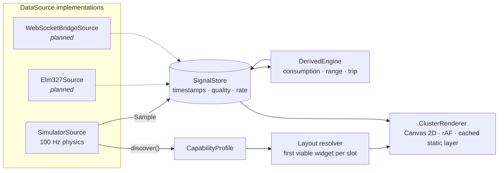

# OpenCluster

An adaptive, themeable virtual instrument cluster (digital cockpit) for the browser. It runs
from a pluggable data-source layer: a physics simulator today, a real ELM327 OBD-II adapter
and a Raspberry Pi CAN-bus bridge on the roadmap.

> **Status: Milestone 1 (skeleton) of 8.** The classic layout, the Midnight theme and the
> physics simulator work. See the [roadmap](#roadmap).

## Quick start

```bash
npm install
npm run dev        # http://localhost:5173
npm test           # unit tests (Vitest)
npm run test:e2e   # browser smoke test (Playwright)
```

Keyboard: `W` throttle, `S` brake, `Q`/`E` paddle shifts, `,`/`.` indicators, `P` toggles the
autopilot. The autopilot takes over again 8 s after your last input.

## Architecture



- **Signals** use COVESA VSS-style IDs (`Vehicle.Speed`, `Vehicle.Powertrain.CombustionEngine.Speed`, …).
  Every sample is timestamped. A signal that misses 4× its expected interval is marked
  `stale`, and its widget dims instead of silently freezing.
- **High-frequency data never goes through React.** The renderer reads the store directly each
  frame. React polls it at a few Hz for the UI chrome.
- **Needles** follow a spring–damper model with a slew limit, so they have the inertia of a
  stepper-motor gauge. Digital readouts are smoothed and refresh at 5 Hz.
- **Layouts and themes are data.** A layout slot lists candidate widgets in order, and the first
  one whose signals the car provides (or that can be derived) wins. A car with no fuel-level
  PID gets no fake fuel gauge.
- **The simulator** is deterministic and seedable. It models a torque curve, a turbo with lag,
  idle control, a rev limiter with cut bounce, engine braking and overrun fuel cut, plus a gearbox
  with throttle-dependent shift points, kickdown and launch slip. It also covers aero, rolling and
  brake forces, coolant and oil warm-up, MAF-based fuel flow and charging voltage.

```
src/
  core/        signals, datasource (+ simulator), derived, smoothing, math
  cluster/     renderer, widgets, layouts, themes
  app/         React shell, session wiring, keyboard controls
  profiles/    simulated vehicle profiles (JSON)
```

## Roadmap

| #   | Milestone                                                                                 | State |
| --- | ----------------------------------------------------------------------------------------- | ----- |
| 1   | Skeleton: render loop, signal store, simulator, classic layout, one theme, spring needles | ✅    |
| 2   | Full simulator, scenarios, telltales, alerts, startup sweep                               | ⏳    |
| 3   | Theme system, 6+ themes, animated switching, theme editor                                 | ⏳    |
| 4   | Layout engine, all layouts, capability detection, 6 vehicle profiles, scan animation      | ⏳    |
| 5   | 3D car, navigation map, media/phone cards, cluster menus, i18n                            | ⏳    |
| 6   | Demo website, inspector, realism toggle, kiosk mode                                       | ⏳    |
| 7   | ELM327 via Web Bluetooth and Web Serial, recording and replay, DTCs                       | ⏳    |
| 8   | Python WebSocket bridge (SocketCAN), docs, deploy, performance pass                       | ⏳    |

## Disclaimer

OpenCluster is not affiliated with any vehicle manufacturer and is not a certified safety device.
Use it as a supplementary display only, and never configure it while driving.

## License

MIT. See [LICENSE](LICENSE).
