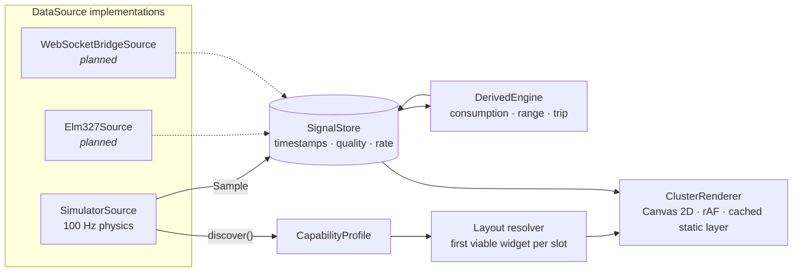

# OpenCluster

An adaptive, themeable virtual instrument cluster (digital cockpit) for the browser. It runs
from a pluggable data-source layer: a physics simulator today, a real ELM327 OBD-II adapter
and a Raspberry Pi CAN-bus bridge on the roadmap.

> **Status: Milestone 3 (theme system).** The classic layout, the Midnight theme and the
> physics simulator work. See the [roadmap](#roadmap).


| Parked                             | Near redline (manual)                    | Night                                |
| ---------------------------------- | ---------------------------------------- | ------------------------------------ |
|  |  |  |

## Quick start

```bash
npm install
npm run dev        # http://localhost:5173
npm test           # unit tests (Vitest)
npm run test:e2e   # browser smoke test (Playwright)
```

Keyboard: `W`/`S` throttle/brake, `Q`/`E` paddle shifts, `,`/`.` indicators, `H` high beam,
`Space` hazard lights, `C` cruise control, `F` fog light, `K` ignition, `1`–`6` scenarios (city,
highway, mountain, track, night, cold start), `N` night mode (auto/on/off), `M` mute, `G` engine
sound, `T` cycles themes, `←`/`→` centre pages, `Enter` acknowledges an alert, and `P` toggles the autopilot. The
autopilot takes over again 8 s after your last input. In attract mode it cycles through the
scenarios.

URL options: `?kiosk=1` shows only the cluster (for a real screen), `?lowpower=1` turns off bloom,
glass and blur, `?pose=idle|city|highway|redline|night` puts the simulator into a reproducible
state, and `?profile=1` collects per-widget frame timings in `window.__clusterProfile`.

### Visual review

`node scripts/screenshots.mjs` (with the dev server running) renders the deterministic poses at
1920×720 into `docs/screenshots/`. These shots serve as the visual regression baselines.

## Architecture



- **Signals** use COVESA VSS-style IDs (`Vehicle.Speed`, `Vehicle.Powertrain.CombustionEngine.Speed`, …).
  Every sample is timestamped. A signal that misses 4× its expected interval is marked
  `stale`, and its widget dims instead of silently freezing.
- **High-frequency data never goes through React.** The renderer reads the store directly each
  frame. React polls it at a few Hz for the UI chrome.
- **Needles** follow a spring–damper model with a slew limit, so they have the inertia of a
  stepper-motor gauge. Digital readouts are smoothed and refresh at 5 Hz.
- **Built like a physical display.** A layout-defined display mask (arched top, tapered sides)
  fades into true black with no border. Each dial is layered: metallic bezel, tick band with a
  three-level tick hierarchy, face, hub ring, and a filled redline band that glows as the needle
  approaches. Emissive elements feed a bloom pass, and a glass reflection and dither noise sit on
  top. Every one of these is a theme token, and low-power mode turns them off.
- **Ignition choreography.** At start-up the logo is revealed, the needles sweep to the stops and
  back, and every warning lamp lights for about 1.5 s as a bulb check. At shut-down a trip summary
  card is shown. Night mode dims the display automatically when it gets dark outside.
- **Alerts are data-driven.** Each rule has thresholds with hysteresis, a minimum duration and a
  severity. A priority queue drives the popup cards, which recommend an action. Chimes are
  synthesized with Web Audio (no sample files), and the flasher relay tick stays in phase with the
  arrows. Telltale colours and positions never change with the theme.
- **Six vehicle profiles** (petrol hatchback, diesel estate, sports coupé, EV, hybrid SUV and a
  full-sensor dev car) each expose a different set of supported PIDs. ICE, EV (with regen) and
  power-split hybrid powertrains share one chassis model with lateral g, gradients,
  traction control and ABS, and tyre pressures.
- **Seven themes** (Midnight, Neon Grid, Racing, Analog Heritage, Arctic, Eco/EV, Retro LCD)
  change everything from dial construction to backdrop, fonts, needle physics and chime voice. Theme
  switches cross-fade, and a live theme editor exports and imports JSON. See [docs/THEMES.md](docs/THEMES.md).
- **Layouts and themes are data.** A layout slot lists candidate widgets in order, and the first
  one whose signals the car provides (or that can be derived) wins. A car with no fuel-level
  PID gets no fake fuel gauge.
- **The simulator** is deterministic and seedable. It models a torque curve, a turbo with lag,
  idle control, a rev limiter with cut bounce, engine braking and overrun fuel cut, plus a gearbox
  with throttle-dependent shift points, kickdown and launch slip. It also covers aero, rolling and
  brake forces, coolant and oil warm-up, MAF-based fuel flow and charging voltage.

```
src/
  core/        signals, datasource (+ simulator), derived, smoothing, math
  cluster/     renderer, widgets, layouts, themes
  app/         React shell, session wiring, keyboard controls
  profiles/    simulated vehicle profiles (JSON)
```

## Roadmap

| #   | Milestone                                                                                 | State |
| --- | ----------------------------------------------------------------------------------------- | ----- |
| 1   | Skeleton: render loop, signal store, simulator, classic layout, one theme, spring needles | ✅    |
| 2   | Full simulator, scenarios, telltales, alerts, startup sweep                               | ⏳    |
| 3   | Theme system, 6+ themes, animated switching, theme editor                                 | ⏳    |
| 4   | Layout engine, all layouts, capability detection, 6 vehicle profiles, scan animation      | ⏳    |
| 5   | 3D car, navigation map, media/phone cards, cluster menus, i18n                            | ⏳    |
| 6   | Demo website, inspector, realism toggle, kiosk mode                                       | ⏳    |
| 7   | ELM327 via Web Bluetooth and Web Serial, recording and replay, DTCs                       | ⏳    |
| 8   | Python WebSocket bridge (SocketCAN), docs, deploy, performance pass                       | ⏳    |

## Disclaimer

OpenCluster is not affiliated with any vehicle manufacturer and is not a certified safety device.
Use it as a supplementary display only, and never configure it while driving.

## License

MIT. See [LICENSE](LICENSE).
