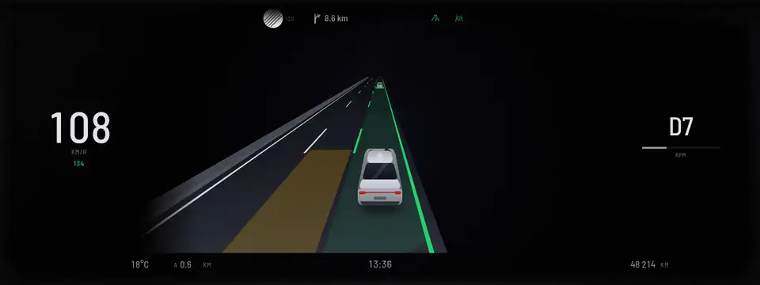
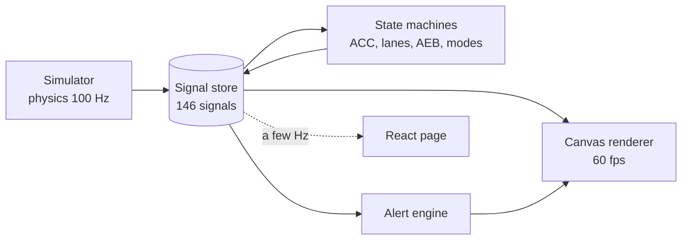

# Kilodash

**A digital instrument cluster that behaves like a real car's, in the browser.**

<!-- TODO(owner): confirm the live URL after the first Pages deploy. -->

**[Live demo](https://michalkujawski.github.io/kilodash/)** · [How it's built](docs/ARCHITECTURE.md) ·
[Features](docs/FEATURE_INVENTORY.md) · [Docs](docs/README.md)

[](https://github.com/MichalKujawski/kilodash/actions/workflows/ci.yml)
[](LICENSE)



Every needle, lamp and warning comes from a simulated car. Adaptive cruise, lane centering, emergency
braking, drive modes and start-stop are small, tested state machines; the cluster only draws their
state, on a Canvas at 60 fps.

## Try it

- **Watch:** the site opens on a guided drive in nine chapters: motorway assists, emergency braking,
  drive modes, the city at a red light, night, menus and parking. Every chapter has its own link, for
  example [`?chapter=safety`](https://michalkujawski.github.io/kilodash/?chapter=safety).
- **Drive:** take the wheel. Indicator stalk, steering-wheel buttons, selector and pedals, by mouse,
  touch, keyboard or gamepad. Press `?` for every key.
- **Engineer:** the internals, live. Signals, state diagrams lighting up as the car drives, an event
  timeline, a Workshop to cause faults, and a "How it works" page for each feature.

## What it does

| Area              | Highlights                                                                                                                                                                                                  |
| ----------------- | ----------------------------------------------------------------------------------------------------------------------------------------------------------------------------------------------------------- |
| Driver assistance | Adaptive cruise with stop & go, lane centering with staged hands-off warnings, collision warning and emergency braking, blind spot, speed-limit recognition and speed warning, park assist with rear camera |
| Powertrain        | Seven drive modes, Eco coasting, cylinder deactivation, start-stop with reasons, Auto Hold, shift lights; petrol, diesel, hybrid and electric cars                                                          |
| Warnings          | 48 warnings with real priorities: red ones stay, amber ones come back after 5 minutes, several take turns                                                                                                   |
| The cluster       | Six views, a 3D navigation map, a lane view with traffic, 31 telltales in fixed positions, needle sweep and lamp check at start-up                                                                          |
| The world         | A deterministic simulator at 100 Hz on a 21 km route with German speed limits, traffic lights, weather and traffic                                                                                          |

Every feature has a page with the real-car behaviour it models, how it's simulated, its thresholds and a
state diagram: [docs/features](docs/features/).

## How it's built



- **Vehicle data never goes through React.** The canvas renderer reads the signal store every frame;
  React polls it a few times a second for the page around the cluster.
- **Behaviour lives in `src/core`** as small classes with plain input and output, each with tests that
  read like the rule ("emergency braking on a slower car ends at its speed").
- **Signals use VSS-style IDs** (`Vehicle.Speed`), with timestamps and quality, behind a data-source
  interface a real car could implement.
- **Layouts and themes are data.** Warning lamp colours and positions are fixed, so no theme can hide them.
- **The guided demo plays in the live simulation,** so a visitor can take over at any moment.

More: [architecture](docs/ARCHITECTURE.md), [six decision records](docs/adr/README.md),
[codebase walkthrough](docs/WALKTHROUGH.md), [HMI and safety](docs/HMI_AND_SAFETY.md).

## Numbers

All measured by `npm run stats` ([docs/PROJECT_STATS.md](docs/PROJECT_STATS.md)).

| Measure            | Value                                                            |
| ------------------ | ---------------------------------------------------------------- |
| Unit tests         | 252 passing (37 files)                                           |
| Browser tests      | 16 passing (Chromium, Firefox; WebKit in CI)                     |
| Frame rate         | 60.0 fps, 1 dropped frame in 60 s of the guided demo             |
| First moving frame | 322 ms (production build, desktop)                               |
| First load         | 160 KB gzip (JS + CSS) + 161 KB fonts                            |
| Lighthouse         | desktop 100 / 100 / 100 / 100; mobile performance 90, others 100 |

## Run it locally

Needs Node 26 (see `.nvmrc`).

```bash
npm ci
npm run dev                 # http://localhost:5173
npm test                    # unit tests (Vitest)
npx playwright test         # browser tests on the production build
npm run stats               # re-measure docs/PROJECT_STATS.md
```

URL options: `?mode=watch|drive|engineer`, `?chapter=<id>`, `?kiosk=1` (cluster only, for a real
1920×720 screen), `?lowpower=1`. All of them: [docs/CONTROLS.md](docs/CONTROLS.md#url-options).

## Tech

TypeScript, React 18, Canvas 2D, Vite, Vitest, Playwright, GitHub Actions and Pages. At run time only
React and two self-hosted font packages; no chart, map, 3D or game libraries.

## How it was made

Built spec-first: a written brief of how real cars behave, small steps each checked by lint, types, tests,
a production build and browser tests, and screenshots reviewed after every visual change. An AI coding
assistant did much of the typing under the rules in [CLAUDE.md](CLAUDE.md); the decisions, specs and
reviews are mine. The paper trail is in [docs/process](docs/process/README.md).

## Limits

A demonstration, not automotive software: not certified, not real time, no real vehicle connection. What
it simplifies and what hasn't been tested: [docs/RISKS_AND_LIMITATIONS.md](docs/RISKS_AND_LIMITATIONS.md).

Not affiliated with any vehicle manufacturer; see the [disclaimer](DISCLAIMER.md).

## License

[MIT](LICENSE). Third-party licences: [THIRD_PARTY_NOTICES.md](THIRD_PARTY_NOTICES.md).
