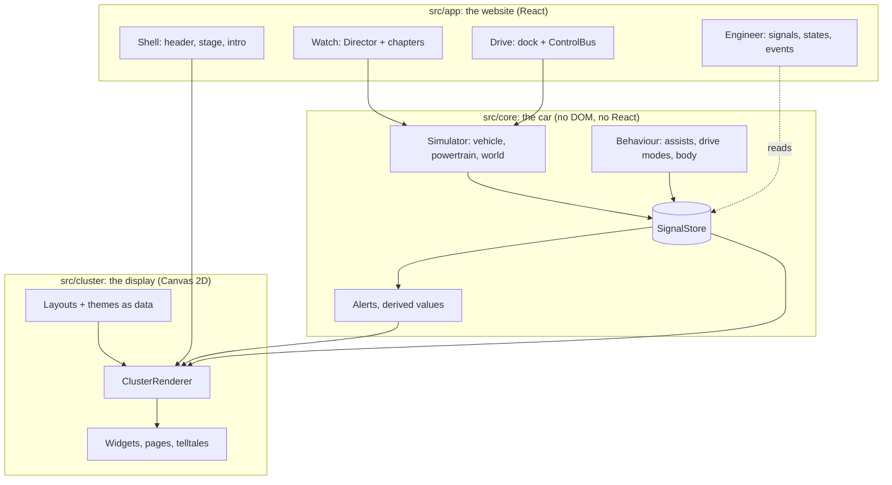

# Architecture

Kilodash is a static web app: Vite, React 18, TypeScript and one Canvas 2D renderer. There is no server.
This page covers the shape of the system and the rules that keep it fast and testable. For a guided
read through the code, see [WALKTHROUGH](WALKTHROUGH.md). For the reasons behind each choice, see the
[decision records](adr/README.md).

## Layers

| Layer    | Folder         | Depends on        | Rule                                                                          |
| -------- | -------------- | ----------------- | ----------------------------------------------------------------------------- |
| Car      | `src/core`     | nothing           | Pure TypeScript. No DOM, no React. Clocks are injectable (tests pass a fake). |
| Display  | `src/cluster`  | `core`            | Draws state; contains no car logic. Never imports React.                      |
| Website  | `src/app`      | `core`, `cluster` | Page chrome, input, the guided demo. Never touches per-frame vehicle data.    |
| Profiles | `src/profiles` | –                 | Six car profiles as JSON (engine, gearbox, equipment, OBD support).           |

## Two data channels

1. **Scalars through the `SignalStore`.** Speed, rpm, lamps and assist states are timestamped numbers with
   VSS-style IDs (`Vehicle.Speed`). The store keeps the latest two samples per signal, so it can
   interpolate between them, report quality (`live`, `stale`, `unavailable`) and measure the real update
   rate. All [146 signals](SIGNALS.md) are listed with units, ranges and the OBD-II PID that would carry
   them on a real car.
2. **Structured data through the scene snapshot.** Traffic objects, lane lines, navigation, road signs
   and the environment come from `World.snapshot()`, like the object list a front camera sends. Lists don't
   fit a scalar store, and this keeps the store allocation-free.

Both channels sit behind the `DataSource` interface (`core/datasource/types.ts`). Widgets don't know
whether the data comes from the simulator or a real car.

## Loops and rates

Each part runs at the rate its job needs, and nothing high-rate goes through React.

| Loop                   | Rate            | Where                                         | Why this rate                                           |
| ---------------------- | --------------- | --------------------------------------------- | ------------------------------------------------------- |
| Physics step           | 100 Hz fixed    | `SimulatorSource` (`STEP_S = 0.01`)           | Stable integration; deterministic for tests             |
| Signal emission        | 50 Hz / 10 Hz   | `SimulatorSource` (`HIGH_EVERY`, `LOW_EVERY`) | Close to real CAN rates for fast and slow signals       |
| Renderer               | display refresh | `ClusterRenderer` (`requestAnimationFrame`)   | Needles and lamps need every frame                      |
| Derived values         | 10 Hz           | `session.ts` (`DERIVED_HZ`)                   | Consumption, range and trip change slowly               |
| Alert engine           | 5 Hz            | `session.ts` (`ALERTS_HZ`)                    | Rules have minimum durations of ≥ 0.5 s anyway          |
| Guided demo (Director) | 10 Hz           | `useDirector.ts`                              | Events are scripted to 0.5 s; capped after a hidden tab |
| React UI polling       | 4–8 Hz          | `useSignal.ts`                                | Text on the page, not animation                         |

## Behaviour as state machines

Every car feature that decides something is a small class in `src/core` with a `step(input, dt)` method
and plain-object output: `SpeedAssist` (cruise, ACC, limiter), `LaneAssist`, `CollisionAssist`,
`SpeedLimitRecognition`, `DriveModeController`, `StartStop`, `ParkAssist`, the seat-belt and tyre
monitors and others (20 classes). The simulator applies their outputs (brake requests, steering torque);
the cluster draws their state. Each has unit tests that read like the rule they check. See
[ADR 3](adr/0003-behaviour-as-state-machines.md).

## The renderer

`ClusterRenderer` draws one logical 1920×720 frame, scaled to the device:

1. **Static cache:** dial faces, ticks and numerals are drawn once to an offscreen canvas and redrawn
   only when the theme, layout or size changes.
2. **Widgets:** each widget draws its dynamic parts (needles, readouts, pages) every frame.
3. **Bloom:** emissive shapes (needles, lit lamps) go to a second layer that is blurred and added.
4. **Glass and mask:** a reflection and the shaped display edge. Night mode dims the whole display.

Layouts (`cluster/layouts/`) and themes (`cluster/themes/`) are data. Telltale colours and positions are
fixed by the layout and never come from the theme. See [ADR 5](adr/0005-layouts-and-themes-as-data.md).

## The website

- **Shell** (`app/shell/`): the header, the stage that fits the 1920×720 display into the window with
  a CSS transform (so the canvas is never resized), the intro, and device classes.
- **Watch** (`app/director/`): chapters are data; the `Director` fires their events into the live
  simulator. See [ADR 6](adr/0006-guided-demo-in-the-live-world.md).
- **Drive** (`app/dock/`, `app/controls/`): every input (pointer, key, gamepad) goes through `ControlBus`,
  which gives each control real tap/hold semantics.
- **Engineer** (`app/engineer/`): reads the store, the state machines and an event log; renders the
  feature docs in a side sheet.
- **Lazy loading** (`app/lazy.ts`): everything off-screen at first load (Engineer, Drive dock, More
  controls, doc sheet) is split into separate chunks.

## Determinism and testing

The simulator is seeded and steps on a fixed clock (see [ADR 4](adr/0004-deterministic-simulator.md)),
so a test can drive the car for minutes of simulated time in milliseconds and expect the same result
every run.

| Level   | Tool                      | What it covers                                                                       |
| ------- | ------------------------- | ------------------------------------------------------------------------------------ |
| Unit    | Vitest                    | State machines, physics, alerts, store, layouts, director, docs links                |
| Browser | Playwright                | Production build in Chromium, Firefox, WebKit (CI): modes, chapters, privacy, phones |
| Visual  | `scripts/screenshots.mjs` | Fixed poses on the GPU, with fps and dropped frames                                  |
| Numbers | `npm run stats`           | Every figure in the README, measured ([PROJECT_STATS](PROJECT_STATS.md))             |

## Build and deploy

`npm run build` type-checks and produces a static `dist/` (about 160 KB gzip for the first load). CI
(`.github/workflows/ci.yml`) runs the same checks as a local commit and the browser tests in three engines. Vercel builds every push
from the repository (`vercel.json`): `main` goes to production, other branches get preview URLs.
