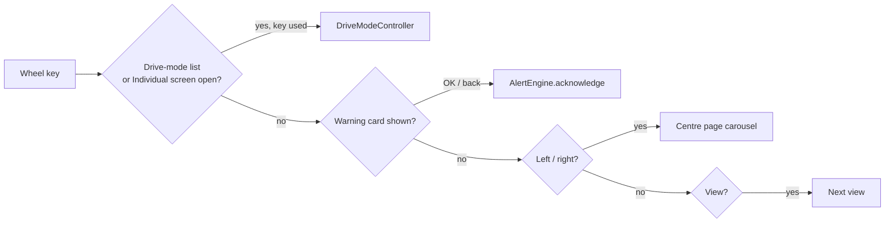
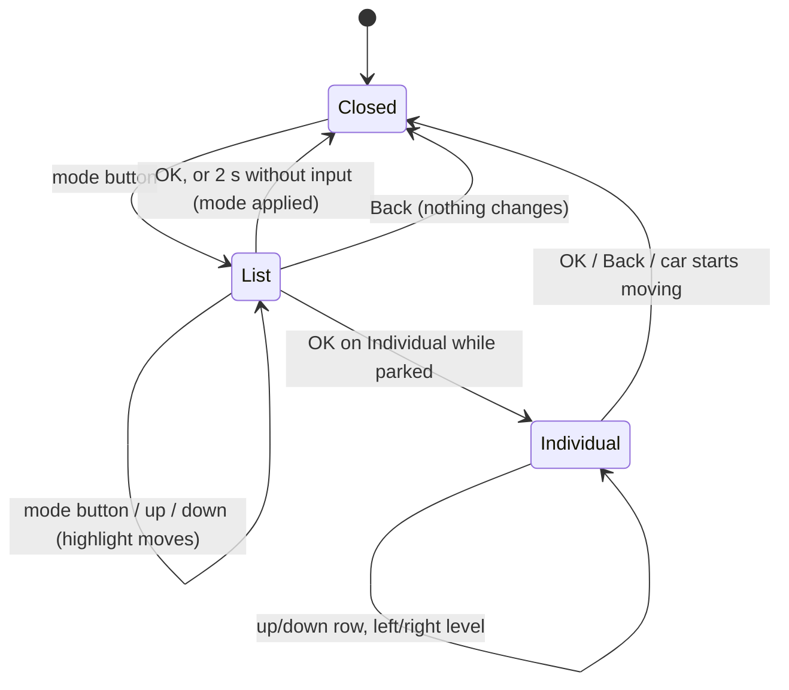

# Menu system

How the steering-wheel buttons move through the cluster. Real clusters keep the driver's hands on the
wheel: one rocker or scroll wheel for pages, one button for views, OK to confirm or dismiss. Kilodash
follows that model and keeps it shallow: everything reachable while driving is at most one level deep.

## Keys

The left steering-wheel group (`app/controls/actions.ts`), with keyboard equivalents:

| Wheel control           | Key            | Does                                                                 |
| ----------------------- | -------------- | -------------------------------------------------------------------- |
| Left / right            | ← / →          | Previous / next centre page                                          |
| Scroll up / down        | ↑ / ↓          | Move the highlight in a list (drive modes, Individual screen)        |
| OK (press scroll wheel) | Enter          | Confirm in a list; acknowledge the warning card                      |
| OK, held                | Enter (hold)   | Long press; treated as OK in lists                                   |
| View                    | V              | Next view                                                            |
| Menu / back             | Esc, Backspace | Close a list without changing anything; acknowledge the warning card |
| Home                    | Home           | Reserved (no deep menu to return from; see Limits)                   |

## Where a key goes

Keys are offered to the frontmost thing first, like focus in a real HMI:

Code: `ControlBus.cluster()` → `DriveModeController` while its list is open, otherwise
`ClusterRenderer.input()`, which asks each widget's `onInput` in turn (the warning card first, then the
carousel) before handling View.

## Centre pages (Classic view)

Left and right move through the pages; the carousel slides and wraps the short way round.

| Page              | Shows                                                                   | Shown when                                                      |
| ----------------- | ----------------------------------------------------------------------- | --------------------------------------------------------------- |
| Map               | 3D navigation map, route, next turn                                     | always                                                          |
| Driver assistance | Lane view: lines, traffic, ACC target, blind spots                      | always                                                          |
| Vehicle status    | Top-down car: doors, lamps, indicators, tyre pressures, start-stop info | always                                                          |
| Trip              | Trip distance, range, average consumption and speed, drive time         | always                                                          |
| Efficiency        | What is saving fuel now, one tip, comfort consumers                     | always                                                          |
| Off-road          | Compass, altitude, wheel angle, temperatures, hill descent              | all-wheel-drive cars; opens itself when Off-road mode is chosen |
| Vehicle messages  | Every active warning, including acknowledged ones                       | always                                                          |

## Views

View cycles Classic → Navigation → Reduced → Driver assistance → Sport → Auto view
([views](features/views.md)). The view's name shows briefly. Every view keeps speed, gear, the limit sign,
telltales and warnings.

## Drive-mode list

The console's mode button opens a list over the centre area (`cluster/widgets/system/DriveModePopup.ts`).

- The **Individual** screen has seven rows (engine, gearbox, steering, dampers, air conditioning,
  adaptive cruise, sound), each Eco / Normal / Sport. It opens only when parked (P or parking brake),
  like a real car's settings that are locked while driving, and closes if the car moves.
- Only the modes the car has are listed ([drive modes](features/drive-modes.md)).

## Warning cards

OK or Back acknowledges the card on screen. A red warning's card can be hidden but its lamp stays; an
amber one comes back after 5 minutes if still present ([warnings](features/warnings.md)).

## Limits

There is no deep settings menu on the cluster. The settings a car keeps there (collision warning on/off,
speed warning and tolerance, service reset, tyre-pressure store) are in the website's Workshop drawer in
Engineer mode, so Home and the scroll keys have nothing to do outside the drive-mode list. See
[RISKS_AND_LIMITATIONS](RISKS_AND_LIMITATIONS.md).
