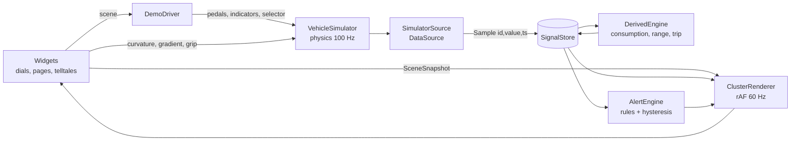

# Codebase walkthrough

A guided tour for learning the code. Read it top to bottom once, then use it as a map.

## The one-sentence version

A **simulated car** produces numbers, the numbers go into a **signal store**, small **state machines**
turn them into decisions (alerts, assists, derived values), and a **canvas renderer** draws the cluster
60 times a second by reading the store directly. React only builds the page around it.

## Where to start reading

1. `src/app/App.tsx`: the page. Creates a `ClusterSession`, mounts `ClusterView`, wires the keyboard.
2. `src/app/session.ts`: one vehicle session. It connects the data source to the store and runs the
   derived engine and alert engine on timers.
3. `src/core/datasource/simulator/SimulatorSource.ts`: the simulated car seen as a `DataSource`. It
   steps physics at 100 Hz and emits samples.
4. `src/cluster/renderer/ClusterRenderer.ts`: the frame loop and layer composition.
5. `src/cluster/widgets/RoundDial.ts`: the most complex widget. It shows how a widget draws its static
   parts once and its dynamic parts every frame.

## How data flows, from simulator to pixels

- **Samples** are tiny `{ id, value, ts, source }` objects with VSS-style IDs (`Vehicle.Speed`). See
  `src/core/signals/catalog.ts`.
- **The store** keeps the latest two samples per signal. From those it can predict values between
  samples, report quality (`live`/`stale`/`unavailable`) and measure the real update rate.
- **Two channels.** Scalars (speed, rpm, lamps) go through the store. Structured data (traffic objects,
  navigation, signs, environment) goes through the `SceneSnapshot` that `World.snapshot()` builds,
  like the object list a car's front camera sends. The car's own UI state (driving-mode list,
  efficiency tips) rides on the same snapshot.
- **Car behaviour lives in `src/core`** as small state machines (`core/drive/` for driving modes).
  The simulator applies their outputs; widgets only draw them.
- **Widgets never know** whether data comes from the simulator or a real car. That is the point of the
  `DataSource` interface (`src/core/datasource/types.ts`).

## The most important files

| File                                      | What it does and why                                                                   |
| ----------------------------------------- | -------------------------------------------------------------------------------------- |
| `core/signals/store.ts`                   | Latest values, quality and rate per signal. Lives outside React for speed.             |
| `core/datasource/simulator/vehicle.ts`    | Chassis, body, ignition, thermals, electrics, faults. Pure `step(dt)`, deterministic.  |
| `core/datasource/simulator/powertrain.ts` | ICE (torque curve, turbo, gearbox), EV (regen, SoC), hybrid (engine start/stop).       |
| `core/smoothing/spring.ts`                | Spring–damper needle physics and rate-limited digital readouts: why needles look real. |
| `core/derived/DerivedEngine.ts`           | Computes what the car doesn't report: consumption, range, trip, boost.                 |
| `core/alerts/AlertEngine.ts` + `rules.ts` | Data-driven warnings with hysteresis, minimum duration and priority.                   |
| `core/drive/DriveModeController.ts`       | Driving-mode selection state machine, Eco coasting rule, cylinder deactivation.        |
| `cluster/renderer/ClusterRenderer.ts`     | Frame loop: static cache → widgets → bloom → glass → display mask.                     |
| `cluster/renderer/startup.ts`             | Ignition choreography: needle sweep, bulb check, trip summary.                         |
| `cluster/layouts/classic.ts`              | Layout as data: slots, rects, candidate widgets, telltale positions.                   |
| `cluster/themes/midnight.ts`              | Every colour, size and effect strength as tokens.                                      |

## How to add things

- **A signal:** add an ID and definition to `core/signals/catalog.ts`, then emit it from the simulator
  (`SimulatorSource.values()`).
- **A widget:** implement `Widget` (`draw`, optional `drawStatic`), export a `WidgetFactory`, register it
  in `cluster/widgets/registry.ts`, then place it in a layout's `slots`.
- **A centre page:** implement `CenterPage` in `cluster/widgets/center/` and add its id to the
  carousel's `PAGE_FACTORIES`.
- **An alert:** add a rule to `core/alerts/rules.ts` (condition, clear condition, severity, icon, text
  keys) and the texts to `core/i18n/en.ts` / `pl.ts`.
- **A telltale:** draw the icon in `cluster/telltales/icons.ts`, add a definition with its condition in
  `telltales/definitions.ts`, and give it a fixed position in the layout.

## Testing and visual review

- `npm test`: unit tests sit next to the code (`*.test.ts`).
- `?pose=idle|city|highway|redline|night` puts the simulator into a reproducible state.
  `scripts/screenshots.mjs` renders those poses on the GPU and reports fps and dropped frames.
