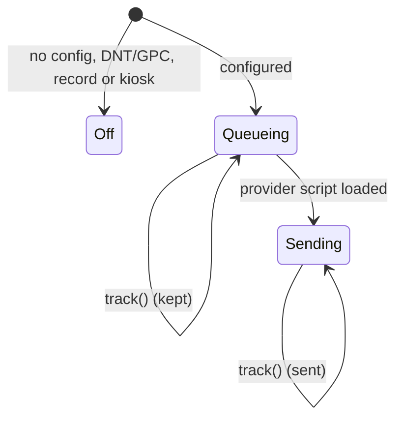

# Analytics and privacy

**What it is.** Optional, cookieless usage counts, so the owner can see what visitors use: which mode,
how far they watch, what they open. It is off unless the build configures it.

**How it works.** `src/app/analytics.ts`:

- `readConfig` turns `VITE_ANALYTICS_PROVIDER` / `_SRC` / `_SITE` into a config, or `null` (off) when any
  of them is missing.
- The provider's script is added only when a config exists. Events from before it loads are queued.
- **Opt-out wins:** Do Not Track, Global Privacy Control, `?record` and `?kiosk` mean no analytics at all.
- **Events:** see the table in `docs/PRIVACY.md`. The Director reports chapters and the completed demo
  through `onChapter` / `onCompleted`.

**Fonts.** Self-hosted (`@fontsource`, latin subset, 160 KB). Loading them from a font CDN shares every
visitor's IP address, which German courts have ruled needs consent. A browser test checks that a visit
contacts no other host.

**Where.** Everywhere, invisibly. Tests: `src/app/analytics.test.ts`, `Director.test.ts` (hooks),
`e2e/smoke.spec.ts` (privacy).
