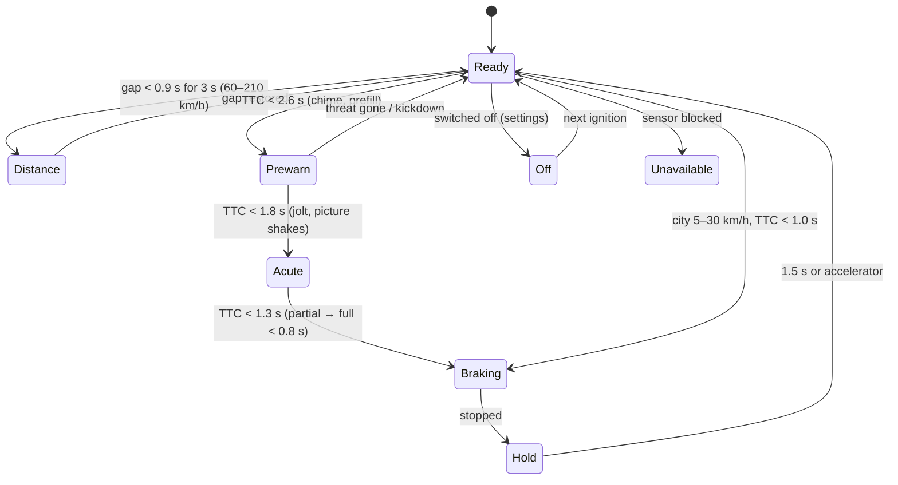

# Collision warning and emergency braking, blind spot, rear cross traffic

## Real-world behaviour this models

- **Forward collision warning and autonomous emergency braking** (mandatory in the EU since 2022):
  - **Distance warning:** following closer than about 0.9 s at 60–210 km/h for a few seconds shows
    a distance symbol.
  - **Pre-warning** (30–210 km/h): when a collision becomes likely, a chime sounds, an amber "Car
    ahead braking" card appears and the brakes are prefilled.
  - **Acute warning:** a red "Brake!" card with a pulsing edge, a faster chime and a short brake
    jolt; the cluster picture jolts with it. Light pre-braking follows.
  - **Automatic braking:** partial at first, full shortly before impact. If the driver brakes too
    softly, brake assist adds the rest. On a stopped car it brakes to a standstill; on a slower
    moving car it brakes until our speed matches it (within about 1 km/h), then hands back to the
    driver. Each stage replaces the previous card at once (critical cards don't wait for a fade).
  - **City emergency braking** (5–30 km/h) brakes without a warning first.
  - After stopping, the car holds for 1.5 s. After an emergency stop from above 50 km/h the hazards
    come on, and go off once the car drives off.
  - It is **on at every start**. It can be switched off only in settings, and while off an amber
    "OFF" telltale shows.
  - A blocked sensor shows a yellow message.
  - Kickdown overrides an intervention.
- **Blind-spot monitoring** (above 15 km/h):
  - A car alongside, or one closing fast from behind (reaching us within 3 s), lights the side's
    indicator. In the cluster this is an amber zone in the lane view.
  - Indicating towards an occupied side makes it flash, with a chime and a message.
- **Rear cross-traffic alert:** while reversing out of a parking space, a car approaching along the
  aisle gives a warning (about 3.5 s before it crosses) and then automatic braking (under 1.6 s).

## How it's simulated

| Part                                                | File                                                              |
| --------------------------------------------------- | ----------------------------------------------------------------- |
| FCW/AEB stages, brake assist, hold, hazards         | `core/assist/CollisionAssist.ts` (`CollisionAssist`)              |
| Blind spot, rear cross traffic                      | `core/assist/CollisionAssist.ts` (`BlindSpot`, `CrossTraffic`)    |
| Wiring: pedals, ACC cancel, hazards, ignition reset | `core/datasource/simulator/SimulatorSource.ts` (`applyCollision`) |
| Car on the car-park aisle as we reverse out         | `core/world/World.ts`, `traffic.ts` (`spawnCrossing`)             |
| Distracted driver (glances up 0.6 s every 2.5 s)    | `core/world/DemoDriver.ts` (`perceivedLead`)                      |
| Alerts, OFF telltale                                | `core/alerts/rules.ts`, `cluster/telltales/definitions.ts`        |
| Picture jolt                                        | `cluster/renderer/ClusterRenderer.ts` (`shake`)                   |
| Blind-spot zones, red car ahead                     | `cluster/lanes/`                                                  |

- **Time to collision** is gap ÷ closing speed. The **required deceleration** is closing² ÷
  2·(gap − 2.5 m), plus whatever the car ahead is braking with.
- **Stages:**
  - Pre-warning at TTC < 2.6 s, if more than 2.5 m/s² would be needed.
  - Acute at TTC < 1.8 s, if more than 4 m/s² would be needed.
  - Partial braking at TTC < 1.3 s.
  - Full braking at TTC < 0.8 s.
  - City braking at TTC < 1.0 s.
- Braking latches until the car stops or the threat is gone, even after the speed drops out of the
  warning band.
- Workshop toggles: "Collision warning" (it comes back on at every start), "Sensor blocked" and
  "Distracted driver".

## Thresholds

| What                         | Value                                      | Why                                 |
| ---------------------------- | ------------------------------------------ | ----------------------------------- |
| Warning band                 | 30–210 km/h                                | Typical radar-based FCW             |
| Distance warning             | < 0.9 s gap, 3 s, 60–210 km/h              | Typical "distance warning" settings |
| Pre-warning / acute          | TTC 2.6 s / 1.8 s                          | Mid ("normal") warning timing       |
| Partial / full braking       | TTC 1.3 s / 0.8 s                          | Staged AEB                          |
| City braking                 | 5–30 km/h, TTC 1.0 s                       | City emergency braking              |
| Hazards after emergency stop | from > 50 km/h                             | ECE R48 behaviour                   |
| Blind spot                   | > 15 km/h; alongside or closing within 3 s | Typical radar BSD                   |
| Cross traffic                | warn < 3.5 s, brake < 1.6 s                | Typical RCTA                        |

Results from the tests:

- With nobody braking, from 50 km/h the car stops short of a stopped car.
- From 100 km/h the impact speed falls below 65 km/h.
- An attentive Demo driver never triggers AEB over the whole route.

## Where it appears

- **Alerts:** "Car ahead braking" (amber), "Brake!" (critical, pulsing, fast repeating chime),
  "Emergency braking", "Distance warning",
  "Collision warning unavailable", "Vehicle in blind spot", "Cross traffic".
- **Telltale row:** the amber collision "OFF" symbol while switched off.
- **Lane view:** the car ahead turns red during a warning; amber zones mark the blind spots and flash
  when indicating towards them.
- **Whole picture:** a short jolt on the acute warning.

## Assumptions

- The simulator has no crash physics. The last-resort "never drive through the car ahead" clamp in
  `SimulatorSource.step` stays as a safety net.
- Rear cross traffic only happens in the starting car park, where reversing happens. The rear camera
  view comes in step 11.
