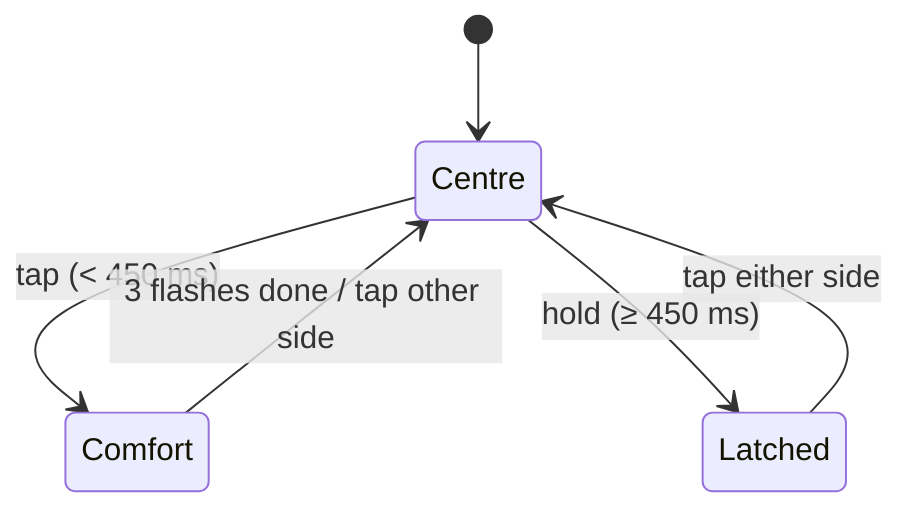

# Car controls (website control panel)

## Real-world behaviour this models

- **Left stalk**
  - Indicators: a short tap gives a comfort blink of 3 flashes; pushing past the detent latches the
    indicator until the stalk returns. Tapping against a latched stalk returns it to the centre.
  - Push for high beam (latched, works only with low beam on); pull to flash (momentary, works any
    time).
  - Auto high beam on/off.
- **Right stalk:** wipers off / auto (rain sensor) / interval / slow / fast, a single wipe, and the
  washer while held.
- **Light switch**
  - off / AUTO / parking lights / low beam. AUTO switches low beam on at dusk, in tunnels and when the
    wipers run (rain).
  - Front fog needs at least parking lights; rear fog needs low beam or front fog.
- **Gear selector:** P R N D, plus S (sport program) and M (manual with paddles). P and R can only be
  selected at standstill (gearbox interlock).
- **Keyless start**
  - Without the brake, the button toggles the ignition.
  - With the brake pressed, it starts the engine.
  - While running and stopped, it switches everything off.
- **Steering wheel, left (cluster):** scroll wheel (up/down, press = OK, hold = long press),
  left/right, View, Menu/back, Home.
- **Steering wheel, right (assist):** cruise/ACC on-off, RES+ / SET− (short press ±1 km/h, hold steps
  to the next 10), distance, cancel, lane assist, voice, volume roller.
- **Console:** drive mode, hazard, start-stop off, ESC (tap = traction control off, hold = ESC sport),
  Auto Hold, park assist.

## How it's simulated

| Part                                                                        | File                                                         |
| --------------------------------------------------------------------------- | ------------------------------------------------------------ |
| Action list and keyboard map                                                | `app/controls/actions.ts`                                    |
| Press/release semantics (tap vs hold, long press, momentary, pedal ramp)    | `app/controls/ControlBus.ts`                                 |
| Keyboard + gamepad                                                          | `app/controls/useControlInputs.ts`                           |
| On-screen controls (SVG + buttons, touch)                                   | `app/controls/ControlPanel.tsx`                              |
| Car-side behaviour (light logic, comfort blink, gear program, start button) | `core/datasource/simulator/vehicle.ts`, `SimulatorSource.ts` |

Some systems arrive in later steps: ACC, lane assist, start-stop, Auto Hold, park assist, drive
modes and views. Until then their buttons keep state (the LED shows it), and the assist pad drives
the plain cruise control.

## Keys

| Key            | Control                              | Key           | Control                |
| -------------- | ------------------------------------ | ------------- | ---------------------- |
| W / S          | accelerator / brake (ramped)         | Q / E         | paddles − / +          |
| , / .          | indicator left / right (tap / hold)  | H / J         | high beam / flash      |
| U              | auto high beam                       | L             | light switch           |
| F / G          | front / rear fog                     | [ / ]         | wipers slower / faster |
| \\ / '         | single wipe / washer                 | 1–6           | P R N D S M            |
| K              | engine start/stop (hold S for start) | Space         | hazard                 |
| Y              | drive mode                           | O             | start-stop off         |
| I              | ESC (hold = sport)                   | A             | Auto Hold              |
| B              | park assist                          | ↑ ↓ ← → Enter | scroll, left/right, OK |
| V / Esc / Home | view / back / home                   | C             | cruise/ACC on-off      |
| - / =          | SET− / RES+                          | X / Z         | cancel / distance      |
| N              | lane assist                          | M             | voice                  |
| PgUp / PgDn    | volume                               | P             | Demo drive on/off      |
| \`             | night mode                           | /             | sound                  |

Gamepad (standard mapping): RT/LT pedals, LB/RB paddles, d-pad scroll/left/right, A OK, B back,
Y view, X cruise, left stick indicators, Start = engine, Back = hazard.

## Thresholds

| What                | Value                            | Why                                                               |
| ------------------- | -------------------------------- | ----------------------------------------------------------------- |
| Long press / latch  | 450 ms                           | Long enough to tell from a tap; matches the feel of stalk detents |
| Comfort blink       | 3 flashes (≈2.1 s)               | Mainstream default                                                |
| Keyboard pedal ramp | 0.5 s to full, 3× faster release | A foot doesn't jump to the floor                                  |
