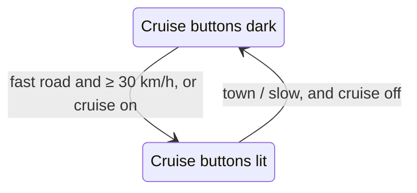

# Drive dock

**Real behaviour.** You drive with a few controls in reach: the indicator stalk, the steering-wheel
buttons, the selector and the pedals. Wheel buttons are backlit; functions that are on show a small lamp.
The cruise buttons are always on the wheel.

**How it is built.** `src/app/dock/` draws those controls under the cockpit in Drive mode. Every button
goes through `ControlBus`, so pointer, keyboard and gamepad behave the same: a tap gives three flashes, a
hold latches the indicator; OK has a long press; the pedals ramp in. The moving parts (blinking arrows,
pedal travel, wheel angle) are written to the DOM from `requestAnimationFrame`, and React polls at 6 Hz.

**Choices.**

- **Cruise buttons:** lit on rural roads, ramps and the motorway at 30 km/h or more, and whenever cruise
  is on (`context.ts`). Elsewhere they stay dark and do nothing. Assumption: a backlight that shows where
  the function is useful; real wheels often light all buttons at night.
- **Wheel picture:** turns with 35 % of the real steering angle, limited to ±15°, so the buttons stay
  readable.
- **Console button:** shows the drive mode while the engine runs, and Start when it is off.
- **At rest:** at most 8 control groups. Everything else is in More controls; every key is in the "?"
  overlay. Key hints show on hover only.
- **First visit:** coach marks for 8 s, or until the first input.

**Where.** Drive mode. Tests: `src/app/dock/context.test.ts`, `e2e/smoke.spec.ts` (dock, "?" overlay).
