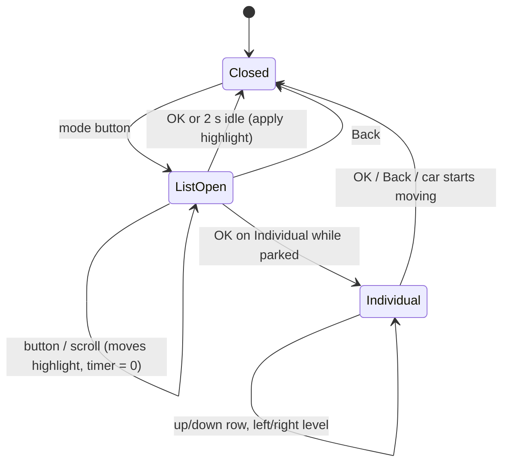
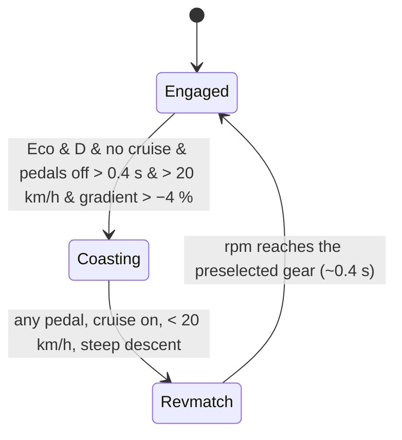

# Driving modes

## Real-world behaviour this models

Mainstream European and Korean cars from about 2015 onwards work alike:

- **A mode button** on the console opens a list in the cluster (or infotainment). Each further press
  moves the highlight down; the steering-wheel scroll wheel moves it too. The highlighted mode is
  applied when you press OK, or **on its own after about 2 s** without input.
- **Modes depend on equipment**:
  - Eco, Normal, Sport and Individual on every car with drive-mode selection.
  - Comfort only with adaptive dampers.
  - Snow and Off-road only with all-wheel drive.
- **The mode resets to Normal at every engine start.** Most brands do this; some let the driver keep
  the last mode, so there is a "Remember drive mode" setting, off by default.
- **What a mode changes:**

  | Mode       | Pedal map    | Gearbox                          | Steering | Dampers | Climate | ACC                | Accent |
  | ---------- | ------------ | -------------------------------- | -------- | ------- | ------- | ------------------ | ------ |
  | Eco        | dull (p^1.5) | E: early upshifts, **coasting**  | light    | normal  | eco     | gentle             | green  |
  | Comfort    | soft (p^1.2) | D                                | light    | soft    | normal  | gentle             | none   |
  | Normal     | linear       | D                                | medium   | normal  | normal  | normal             | none   |
  | Sport      | sharp        | S: holds gears, earlier kickdown | heavy    | firm    | normal  | dynamic            | red    |
  | Individual | per setting  | per setting (never coasts)       | …        | …       | …       | …                  | none   |
  | Snow       | very soft    | pulls away in 2nd                | medium   | normal  | normal  | gentle, larger gap | blue   |
  | Off-road   | progressive  | holds low gears                  | light    | normal  | normal  | normal             | amber  |

  Steering, damper, sound and ACC settings are carried as data. ACC uses its setting ([speed assist](speed-assist.md)).
  The others have no physical effect in the simulator yet.

- **Eco coasting (freewheeling)**, a dual-clutch/automatic feature:
  - Above about 20 km/h, with both pedals released, the clutch opens and the engine drops to idle,
    so the car rolls much further.
  - The gear number disappears and the cluster shows only "E".
  - Any touch of a pedal re-engages: the engine is rev-matched to the preselected gear, then the clutch
    closes.
  - It never coasts with cruise control or ACC on, on steep descents (≤ −4 %), in S or M, or in
    Individual.
- **Cylinder deactivation** (on engines that have it): at steady light load in 3rd gear or above, the
  engine shuts off half its cylinders. Revs don't change; consumption drops by around 10–15 %. It is
  never active in Sport or manual.
- **Individual** can be configured only when parked, in P or with the parking brake on. The settings
  are remembered.
- **Off-road**:
  - Brings up an off-road page: compass, altitude, front-wheel angle, oil and coolant temperature.
  - Arms **hill descent control** below 30 km/h. On a descent steeper than 6 %, with no pedal, it
    brakes to hold a crawl (about 8 km/h).
- **Electric cars**:
  - A **power meter** replaces the tachometer. The needle rests at 0 about a quarter of the way
    round, moves left into CHARGE while regenerating, and right through ECO into POWER.
  - The paddles set **lift-off regeneration** levels 0–3 (left/minus is stronger, right/plus is
    weaker).
  - **B** on the selector gives strong one-pedal regeneration that stops the car.
  - Eco limits power to 60 % and top speed to 130 km/h.
- **Hybrids**: power meter as on EVs, plus an **EV** indicator while the engine is off.
- **Eco tips and comfort consumers**:
  - The efficiency page shows what is saving fuel right now: coasting, or half the cylinders.
  - Otherwise it shows one short tip: shift up, slower than 130 km/h, comfort consumers, or try Eco.
  - Below that, a list of the comfort consumers that are running and what each costs in L/h.

## How it's simulated

| Part                                                          | File                                                         |
| ------------------------------------------------------------- | ------------------------------------------------------------ |
| Mode table, Individual mapping, pedal maps, availability      | `core/drive/modes.ts`                                        |
| Selection state machine, coasting rule, cylinder deactivation | `core/drive/DriveModeController.ts`                          |
| Comfort consumers and eco tips                                | `core/drive/efficiency.ts`                                   |
| Pedal map, coasting, hill descent, consumers in the car       | `core/datasource/simulator/vehicle.ts`                       |
| Shift programs E/S/snow/off-road, freewheel, CDA, EV regen, B | `core/datasource/simulator/powertrain.ts`                    |
| Signals and the mode/efficiency data on the scene snapshot    | `core/datasource/simulator/SimulatorSource.ts`               |
| Mode list and Individual screen                               | `cluster/widgets/system/DriveModePopup.ts`                   |
| Mode label in the tach gap, E/B/regen hub, power meter        | `cluster/widgets/RoundDial.ts`                               |
| Mode symbol and hill-descent icon in the top strip            | `cluster/widgets/StatusStrip.ts`                             |
| Accent glow behind the dials                                  | `cluster/renderer/ClusterRenderer.ts` (`paintModeTint`)      |
| Off-road page, efficiency status/consumers                    | `cluster/widgets/center/OffroadPage.ts`, `EfficiencyPage.ts` |

The engine model also changed in this step and is now torque-based:

- The pedal asks for a share of full-load torque.
- Up to the naturally aspirated level (about 95 Nm/L) the throttle delivers that torque at once.
  More needs boost, which builds with turbo lag once the engine nears its torque plateau.
- Manifold pressure, MAF and fuel follow from the torque actually produced.

This gives realistic cruise consumption: the reference SUV uses about 5.5 L/h at 100 km/h in 7th
at about 2000 rpm.

New signals:

- `Vehicle.Powertrain.DriveMode`: index into `DRIVE_MODE_ORDER`.
- `…Transmission.IsCoasting`
- `…CombustionEngine.IsCylinderDeactivated`
- `…Regeneration.Level`
- `Vehicle.Powertrain.PowerRequest`: % of max power, negative for % of max regeneration.
- `Vehicle.CurrentLocation.Altitude` and `Vehicle.CurrentLocation.Heading`
- `Vehicle.ADAS.HillDescentControl.State`
- `DriveProgram` gains 4 = B.

## Thresholds

| What                         | Value                                                           | Why                                          |
| ---------------------------- | --------------------------------------------------------------- | -------------------------------------------- |
| Popup auto-confirm           | 2 s                                                             | Typical of current mainstream cars           |
| Coasting minimum speed       | 20 km/h                                                         | Below it the gearbox stays engaged for creep |
| Coasting entry delay         | 0.4 s with pedals off                                           | Avoids flicker when changing pedals          |
| Coasting max descent         | −4 %                                                            | Engine braking wanted downhill               |
| Cylinder deactivation window | 1300–4000 rpm, 12–70 % of NA torque, ≥3rd                       | Light, steady load only                      |
| CDA entry                    | 1.5 s steady, throttle rate < 0.25/s                            | Switches only when the load is settled       |
| CDA fuel saving              | 12 %                                                            | Published figures are 0.2–0.4 L/100 km       |
| HDC armed / target           | < 30 km/h / ≈ 8 km/h on > 6 % descent                           | Typical off-road HDC                         |
| EV regen levels (lift-off)   | 0 / 0.05 / 0.10 / 0.15 g, B 0.20 g                              | Common paddle-regen steps                    |
| EV Eco                       | 60 % power, 130 km/h                                            | Typical EV eco limits                        |
| Comfort consumers            | A/C up to 3 kW, rear heater 0.2 kW, seats 0.1 kW, lights 0.1 kW | Typical loads                                |
| Fuel per kW of consumer      | 1 / (8.9 kWh/L × 25 %) ≈ 0.45 L/h                               | Part-load engine plus alternator efficiency  |

## Where it appears

- **Tachometer gap:** the mode name, in the mode's accent colour.
- **Top strip:** the mode symbol, shown for every mode except Normal; the hill-descent icon (grey when
  armed, green when braking).
- **Behind the dials:** a faint glow in the mode's accent colour that cross-fades in about 0.5 s.
- **Gear hub:**
  - "E" with the gear number in Eco; "E" alone while coasting.
  - "S" in Sport.
  - On EVs, D or B, plus a regen-level bar under D.
- **Centre:**
  - The mode list and the Individual screen. The page underneath fades back while they are open.
  - The off-road page, which opens by itself when Off-road is selected.
  - Efficiency page additions: status, tip and consumers.
- **Website:** the console mode button shows the current mode. On EVs the S/M gate becomes B. The
  Workshop has a "Remember drive mode" toggle.

## Assumptions

- Coasting is shown as "E" with no gear number, the most common presentation.
- The power meter shows percent of maximum power (some cars show kW). Percent keeps one scale for every
  car.
- The default regen level on an EV is 1.
