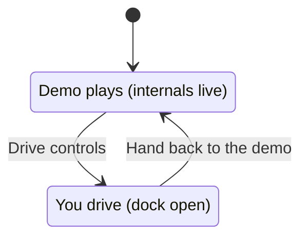

# Engineer mode

**What it is.** The cockpit's internals, live, next to the running cluster. It's for interviewers and
engineers who want to see that the behaviour is real and where it lives in the code.

**How it is built.** `src/app/engineer/`:

| Tab         | What it shows                                                              | Source                                |
| ----------- | -------------------------------------------------------------------------- | ------------------------------------- |
| Signals     | Every signal: value, unit, quality, rate (filterable)                      | `core/signals/store.ts`               |
| States      | Seven live state machines; current state lit, last transition flashing     | `app/engineer/machines.ts`            |
| Events      | Timeline of transitions, warnings and mode changes, with the car's context | `app/engineer/EventLog.ts`            |
| View model  | The data the active page or view draws from, as JSON                       | `app/engineer/viewModel.ts`           |
| Workshop    | World (time, weather, places), faults, occupants, driver state, sensors    | `app/Workshop.tsx`                    |
| Performance | fps, frame time, dropped frames, first cluster frame, render-phase profile | `cluster/renderer/ClusterRenderer.ts` |

- **State diagrams:** only the picture lives in `machines.ts` (layout, transition labels). The live
  state is read from the core classes. A test checks that every live state appears in its diagram.
- **Event log:** samples at 10 Hz for the whole visit and records only differences.
- **How it works:** captions and diagrams open a side sheet. It renders `docs/features/<feature>.md`
  with a small built-in Markdown parser (no dependency) and links to every source file the doc names.
  A test fails if a doc names a file that doesn't exist.
- **Layout:**
  - Wide screens (≥ 1280 px) get a 440 px sidebar. The display shrinks and moves with a CSS transform,
    so the cluster canvas is never resized (a resize rebuilds its caches and costs frames).
  - Narrower screens get the panel under the cockpit.
- **Driving:** the Drive dock is collapsed; opening it hands the car over, and closing it hands it back
  to the demo.

**Thresholds.** Entering Engineer costs about one dropped frame on the production build (React mounts the
panel); the target is zero.

**Where.** `?mode=engineer`. Tests: `src/app/engineer/*.test.ts`, `e2e/smoke.spec.ts`.
