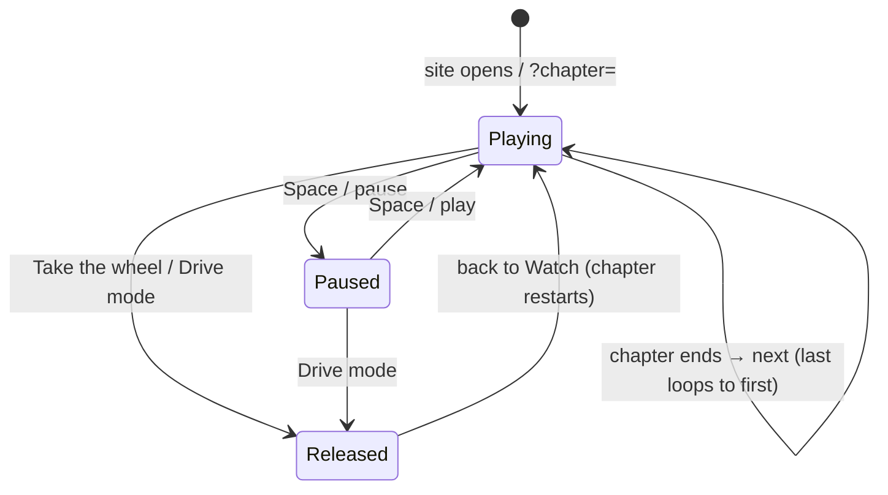

# Guided demo (Watch mode)

**What it is.** The site opens playing a 2½-minute guided drive in nine chapters. Strongest moments come
first: start-up, then the motorway (adaptive cruise, lane centering, blind spot), then emergency braking.

**How it works.** `src/app/director/chapters.ts` holds the chapters as data: a start place, time of day,
weather, drive mode and view, a timeline of events and the captions. `Director` applies the setup and
fires events into the running simulator (switch cruise on, change view, spawn a passing car, make the
car ahead brake, look away). The Demo driver keeps driving between events, so every chapter is the real
simulation, not a recording. Pausing freezes the simulator. "Take the wheel" releases the car where it is.

**Thresholds and choices.**
- The Director ticks at 10 Hz on wall-clock time, capped at 0.25 s per tick so a hidden tab does not fire
  a burst of events.
- Safety: the driver looks down for 7 s and keeps the accelerator steady (≤ 35 %). The car ahead brakes
  from 100 to 40 km/h. Emergency braking avoids the collision with about 3 m to spare.
- Motorway: a car passes at +43 km/h. The scripted lane change waits until the target lane is clear from
  14 m behind to 20 m ahead (mirror and shoulder check).

**Where it appears.** Watch mode, below the cockpit. Keyboard: Space, ← and →. Tests:
`src/app/director/Director.test.ts` (each key moment happens) and `e2e/smoke.spec.ts`.
