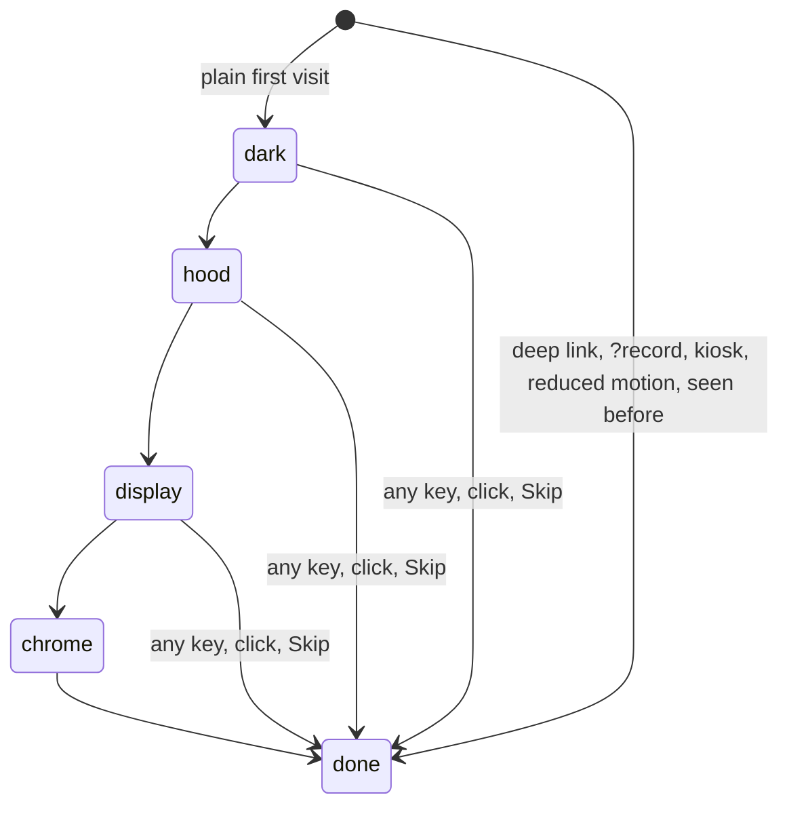

# First-visit intro

**Real behaviour it echoes.** When a premium car wakes up, the cabin light comes up first. Then the
cluster plays its start-up: a logo, a lamp check and a needle sweep.

**How it works.** `src/app/shell/intro.ts` runs a fixed timeline. `.site[data-intro]` drives the fades in
CSS, so nothing extra renders per frame.

| Phase   | From   | What shows                                                         |
| ------- | ------ | ------------------------------------------------------------------ |
| dark    | 0 s    | Black page                                                         |
| hood    | 0.25 s | Hood and glow fade in; a light runs along the hood's edge          |
| display | 1.0 s  | Cluster fades in; the Director starts, so the start-up sweep plays |
| chrome  | 3.1 s  | Header and captions fade in                                        |
| done    | 3.8 s  | Watch; the header's auto-hide timer starts now                     |

**Choices.**

- **When it plays:** only on a plain first visit (`localStorage` `twindial.intro.seen`). Never for deep links
  (`?chapter`, `?mode`, `?pose`), kiosk, recording (`?record`) or `prefers-reduced-motion`.
- **The car keeps rolling underneath,** so the cockpit is moving the moment the display lights up.
- **Cost:** no frames dropped beyond the normal page load (measured: 3 with or without the intro).

**Where.** First load of `/`. Tests: `src/app/shell/intro.test.ts`, `e2e/intro.spec.ts`.
