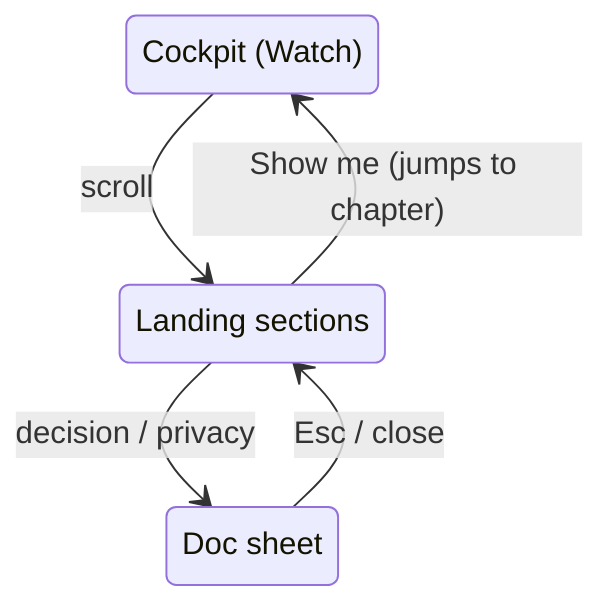

# Landing sections

**What it is.** The page below the cockpit for visitors who scroll: pitch, highlights, how it works,
engineering decisions, tech, about and footer. It is at most 1100 px wide, with one idea per section.

**How it is built.** `src/app/landing/`. The copy lives in `content.ts`; `Landing.tsx` is layout only.

- **Highlights:** "Show me" jumps the guided demo to that chapter and scrolls back up.
  - The posters are still frames from the deterministic poses (`public/media/posters/*.webp`, about 15 KB
    each, lazy-loaded). Step 9 replaces them with short loops.
- **How it works:** the data path from simulator to renderer, with live values from the running car
  (speed, signal count, cruise state, mode, fps) polled at 2 Hz. The connectors animate unless the
  visitor prefers reduced motion.
- **Engineering decisions:** six ADRs (`docs/adr/`), opened in the side sheet.
- **Footer:** disclaimer, MIT licence, privacy note (`docs/PRIVACY.md`, opened in the sheet).
- **Header:** once the page scrolls, it gets a frosted backdrop and stops auto-hiding.

**Where.** Below the cockpit in Watch and Drive (Engineer uses the space for its panel). Test:
`e2e/smoke.spec.ts` (landing).
