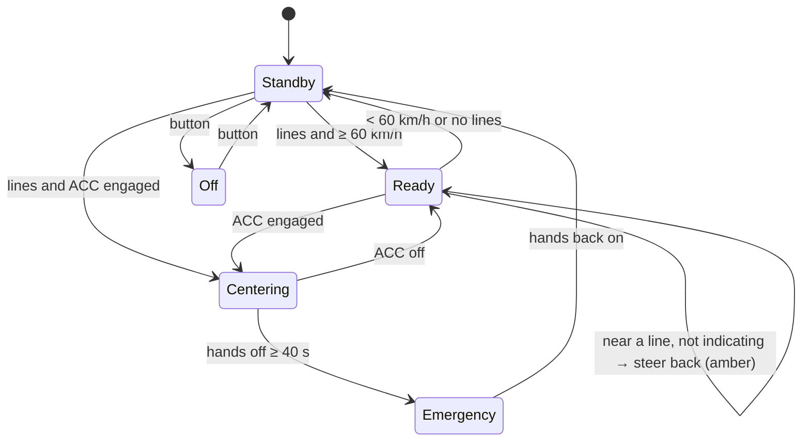
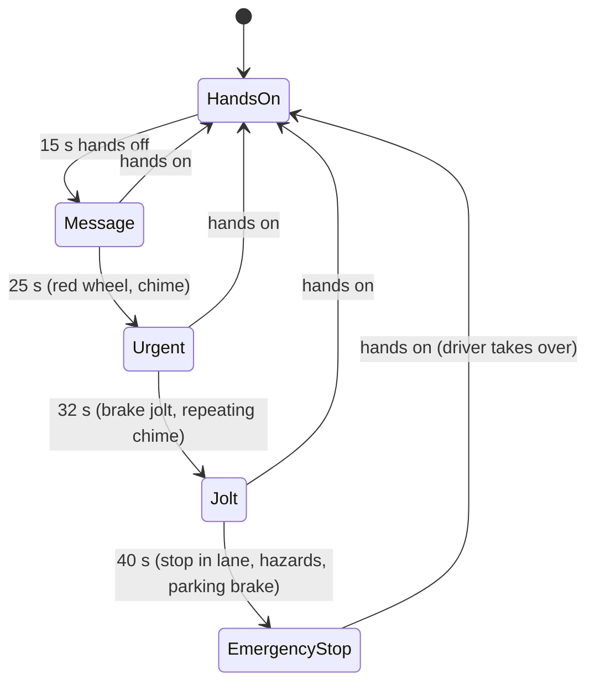

# Lane keeping, lane centering, hands-off staging and the lane view

## Real-world behaviour this models

- **Lane keeping** (most cars since about 2016):
  - Works from about 60 km/h when the camera sees the lane lines.
  - If the car is about to touch a line and the driver isn't indicating, it steers back firmly. The
    line in the cluster flashes amber.
  - Indicating towards the line, or changing lanes, suppresses it.
  - Standby (grey symbol) when too slow or no lines are found: snow, fog, or town streets without
    markings.
- **Lane centering** works together with adaptive cruise control:
  - The car is kept in the middle of the lane at all ACC speeds, down to stop & go.
  - The cluster shows the lines in green and an "assisted driving" symbol.
  - The driver's hands rest on the wheel (the system steers; the driver supervises).
- **Hands-off detection** escalates in stages, as mainstream systems do:
  1. About 15 s: "Take over steering" message and a white wheel symbol.
  2. About 25 s: a red, flashing wheel and a chime.
  3. About 32 s: a short brake jolt and a louder, repeating chime.
  4. About 40 s: **emergency stop**. The car keeps its lane, slows to a stop with the hazard lights
     on, and applies the parking brake.

  Putting the hands back on the wheel at any stage cancels it.

- **Lane view** (driver assistance page):
  - A chase-camera picture of the road ahead, bending with the real road.
  - Our lane's lines: grey (not detected), white (detected), green (steering) or flashing amber
    (departure).
  - Surrounding traffic, including oncoming cars on two-way roads. The car ACC follows is
    highlighted.
  - Our lane is tinted while assisted driving steers.

## How it's simulated

| Part                                                             | File                                                         |
| ---------------------------------------------------------------- | ------------------------------------------------------------ |
| Lane keeping / centering / hands-off state machine               | `core/assist/LaneAssist.ts` (`LaneAssist`)                   |
| The human driver's steering (attentive / distracted / hands off) | `core/assist/LaneAssist.ts` (`driverSteer`)                  |
| Lateral motion in the lane (camber, bends, gusts)                | `core/world/World.ts` (`stepLateral`)                        |
| Line detection, merging steering, jolt and emergency stop        | `core/datasource/simulator/SimulatorSource.ts` (`applyLane`) |
| Alerts for the hands-off stages                                  | `core/alerts/rules.ts`                                       |
| Lane view model (renderer-independent)                           | `cluster/lanes/types.ts`, `buildLaneView.ts`                 |
| Canvas 2D renderer (swappable for WebGL)                         | `cluster/lanes/Canvas2DLaneRenderer.ts`                      |
| Assist page, top-strip symbols                                   | `cluster/widgets/center/AssistPage.ts`, `StatusStrip.ts`     |

- **Lateral model.** The car has a lateral offset and speed in its lane. Disturbances: road camber
  (−0.06 m/s², pulls right), bends (5 % of v²κ outwards) and smooth gusts (±0.12 m/s²).
- **Drivers.** The attentive human is a PD controller with a natural wander of about ±0.2 m. A
  distracted driver reacts about ten times more weakly and drifts onto the lines. Hands off means no
  steering at all.
- **Centering** is a soft spring to the lane middle. Lane keeping pushes back with about 2.2 m/s²
  when the time to the line drops under 0.7 s or the wheels come within 18 cm of it.
- **Lines.** Motorway, ramp and rural roads have both lines. Town streets have only the centre line
  (a kerb on the right). 30 zones, car parks, snow and fog give none.
- **Renderer interface.** `LaneSceneRenderer.draw(ctx, model, rect, theme, now)` with a plain
  `LaneViewModel`. A Three.js renderer can implement the same interface (decision from the Realism
  v2 plan).

The Workshop drawer has "Hands on wheel" and "Distracted driver" toggles to try these out.

## Thresholds

| What                       | Value                            | Why                                      |
| -------------------------- | -------------------------------- | ---------------------------------------- |
| Lane keeping minimum speed | 60 km/h                          | Typical 60–65 km/h                       |
| Line contact               | 0.85 m from the centre           | 3.5 m lane, 1.8 m car                    |
| Intervention trigger       | time to line < 0.7 s or < 18 cm  | Late enough not to annoy                 |
| Intervention strength      | ≈ 2.2 m/s² for ≥ 0.8 s           | A firm but controllable nudge            |
| Hands-off stages           | 15 / 25 / 32 / 40 s              | Typical escalation (EU ALKS-like timing) |
| Emergency deceleration     | 2.5 m/s² above 40 km/h, then 1.5 | Stops without risking a rear-end crash   |

## Where it appears

- **Top strip:**
  - The lane-assist symbol: grey in standby, green when ready or centering, amber while steering
    back.
  - The assisted-driving symbol (a wheel between lane lines) with ACC + centering.
  - The wheel symbol during hands-off stages, white then flashing red.
- **Centre:** the "Driver assistance" page (second page of the carousel) with the lane view.
- **Alerts:** "Take over steering" (info), "Take over steering!" (warning), "Take over steering
  immediately!" (critical, repeating chime), "Emergency stop" (critical).

## Assumptions

- The lane view sees cars up to 140 m ahead and 12 m behind. Blind-spot warnings come in step 8.
- The emergency stop stays in the current lane. Some cars change to the hard shoulder; most stop in
  lane.
