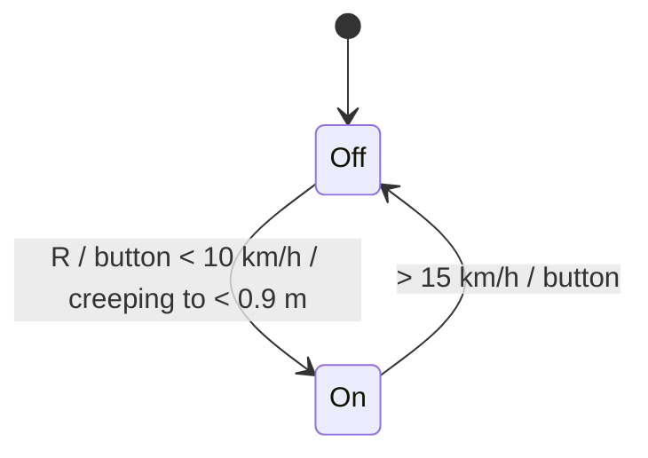

# Park assist, auto high beam, fatigue, lights

- **Park assist** (`core/body/ParkAssist.ts`):
  - On automatically in R, when creeping (< 10 km/h) to within 0.9 m of something ahead, or with
    the button below 10 km/h. Off above 15 km/h.
  - Sectors: green < 1.5 m, yellow < 1.0 m, red < 0.6 m (sides: 0.8 / 0.5 / 0.3 m).
  - Beeps every 0.08–0.58 s depending on distance, continuous under 0.3 m (sides 0.2 m). The front
    beeps are higher-pitched than the rear.
  - A "Park sensor dirty" fault limits it.
  - Distances come from `World.parkDistances`: cars parked beside us and the kerb in the start bay,
    the wall in the destination bay, a car crossing behind, and close traffic.
  - The cluster shows `ParkView`: a top-down car with sectors and, in R, a rear camera (mirrored)
    with static distance lines and path lines that follow the steering angle.
- **Auto high beam** (`core/body/lights.ts`):
  - Armed when switched on (stalk U), low beam on and dark (< 15 % light).
  - Switches the high beam on above 60 km/h (off below 40), outside towns, with no oncoming car
    within 600 m and no car ahead within 350 m. It goes off at once and comes back 1.5 s after the
    road is clear.
  - Green "A" lamp while armed; the blue lamp shows when the high beam is actually on.
- **Fatigue** (`core/body/lights.ts`):
  - Evaluates above 65 km/h for 15 min, looking for drift-then-jerk steering (≥ 3 in 5 min).
  - A coffee cup and gong, once more after 15 min, then quiet.
  - A break of 15 min resets it, as does the engine off or a door opened.
  - "Consider a break" after 2 h of driving.
  - The Workshop "Tired driver" toggle makes the driver nod off for 3 s every 55 s.
- **Lights:**
  - The light sensor reacts in about 1 s (tunnels).
  - The left indicator flashes double-rate with the bulb fault.
  - A green rain-sensor wiper lamp shows in auto with lights on.
  - Parking-light/low-beam and auto-high/high-beam lamps share places in the telltale row.

