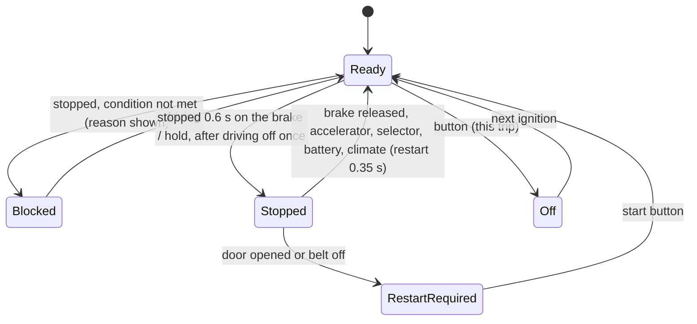
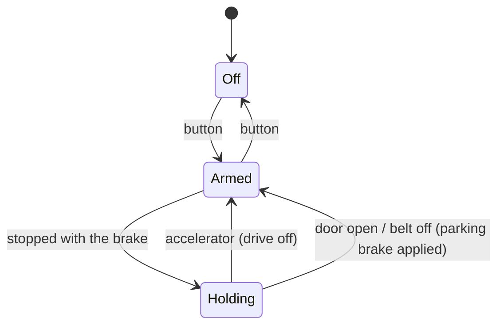

# Start-stop, Auto Hold, gear advice, shift lights and diesel systems

## Real-world behaviour this models

- **Engine start-stop** (combustion cars with the system):
  - At a standstill with the brake held, or with Auto Hold or ACC holding, the engine switches off
    after about half a second. The tach drops to 0 and a green "auto stop" indicator shows.
  - **It restarts** when the brake is released, the accelerator is pressed, the selector leaves D,
    or the car needs the engine (battery, or climate after a long stop).
  - **It stays off** when the engine isn't warm, the battery needs charging, the climate needs the
    engine (very hot or cold), the road is steep, the steering is turned far, a door is open or the
    belt is off, or the particulate filter is cleaning itself. These are not faults: the vehicle
    page shows the reason with a grey crossed symbol.
  - The first stop after a start comes only once the car has driven off.
  - If the driver opens the door or unbuckles while the engine is stopped, it will **not** restart
    on its own. "Start the engine" appears and the start button restarts it.
  - The console button switches it off for the trip; it is **on again at every start**.
- **Auto Hold:** after stopping on the brake, the car keeps holding when the pedal is released. A
  green lamp shows, and the accelerator releases it. If the driver unbuckles or opens the door while
  holding, the electric parking brake takes over. The button setting stays as it was.
- **Gear advice** (required in the EU for manual gear selection):
  - An arrow and a gear number appear next to the gear: shift up early at light load, down when the
    engine labours.
  - It is off in Sport, where the shift lights take over.
- **Shift lights** (Sport, or manual mode): a row of LEDs over the tachometer fills green → amber
  → red over the last ~1 800 rpm, then everything flashes at the shift point.
- **Diesel** (2016 estate):
  - **Glow plugs:** when the engine is cold, the amber coil lamp lights at ignition-on, for up to 3 s.
    A keyless start cranks by itself once glowing is done.
  - **Particulate filter:** soot collects, mostly in slow driving. At a steady speed above 60 km/h
    the engine burns it off. Above 80 % load a lamp and a message ask for such a drive.
  - **Diesel exhaust fluid** (generic name; the common brand name is a trademark), about 1 L per
    1 000 km:
    - A warning from 2 400 km range.
    - Urgent below 1 000 km.
    - Once empty, the engine will not restart (EU rules).
- **Low fuel:** the amber pump lamp and a chime at the reserve (about 12 % of the tank, ~7 L in the
  SUV), reminded every 10 minutes.

## How it's simulated

| Part                                                                           | File                                                                |
| ------------------------------------------------------------------------------ | ------------------------------------------------------------------- |
| Start-stop, Auto Hold, gear advice, shift lights                               | `core/drive/StartStop.ts`                                           |
| Glow time, particulate filter, exhaust fluid                                   | `core/drive/Diesel.ts`                                              |
| Engine auto stop / quick restart (0.35 s), glow before cranking, start blocked | `core/datasource/simulator/vehicle.ts`                              |
| Wiring, gear rpm for advice, Workshop diesel buttons                           | `core/datasource/simulator/SimulatorSource.ts` (`applyStopAndHold`) |
| Telltales (Auto Hold, particulate filter, exhaust fluid, glow)                 | `cluster/telltales/definitions.ts`                                  |
| Auto-stop indicator and gear advice in the tachometer                          | `cluster/widgets/RoundDial.ts`                                      |
| Shift lights                                                                   | `cluster/widgets/ShiftLights.ts`                                    |
| Start-stop reason                                                              | `cluster/widgets/center/CarPage.ts`                                 |

- While auto-stopped, ignition and "ready" stay on. The alternator stops charging (≈12.4 V), and the
  charge and oil lamps stay dark.
- The Demo drive stops the engine at red lights and in the queue once warm: about two auto-stops
  per loop (the test requires at least one). The first stops are blocked because the engine is still
  cold, as in a real car.
- The particulate filter model is time-scaled (×20) so the warning can be seen in a demo. Workshop
  buttons fill the filter, lower the exhaust fluid, or service both.

## Thresholds

| What                       | Value                                                    | Why                                 |
| -------------------------- | -------------------------------------------------------- | ----------------------------------- |
| Stop delay                 | 0.6 s at standstill                                      | Avoids stopping at a momentary halt |
| Engine warm enough         | coolant ≥ 50 °C                                          | Typical minimum                     |
| Climate blocks             | ambient > 30 °C or < −2 °C; restart after 180 s          | A/C or heating demand               |
| Gradient / steering blocks | > 12 % / > 120° at the wheel                             | Hill and junction turning           |
| Quick restart              | ~0.35 s                                                  | Engaged starter / belt starter      |
| Gear advice up             | 2 100 rpm (light), 2 800 (medium), redline − 800 (heavy) | Eco shift points                    |
| Gear advice down           | < idle + 250 rpm                                         | Engine labouring                    |
| Shift lights               | redline − 2 100 … redline − 300 rpm, flash beyond        | Shift point just before the redline |
| Glow time                  | (40 − coolant) / 15 s, 0–3 s                             | Typical modern glow plugs           |
| Particulate filter warning | ≥ 80 % (cleared < 60 %)                                  | Typical "drive to regenerate" point |
| Exhaust fluid warnings     | 2 400 km / 1 000 km / 0                                  | EU-style staged warnings            |

## Where it appears

- **Tachometer gap:**
  - "Auto stop" with the start-stop symbol: green, or amber when a manual restart is needed.
  - A grey crossed symbol next to "Ready" while it can't stop.
- **Hub:** the gear-advice arrow and target gear.
- **Above the tachometer:** the shift lights (Sport / manual).
- **Telltale row:** Auto Hold (green), particulate filter and exhaust fluid (amber), glow plugs
  (amber).
- **Vehicle page:** "Start-stop: <reason>".
- **Alerts:** "Start the engine", "Particulate filter", "Refill exhaust fluid", "Exhaust fluid almost
  empty".
- **Website:** the console start-stop and Auto Hold buttons; diesel Workshop buttons when the estate
  is selected.

## Assumptions

- Hybrids and EVs don't use this start-stop. Hybrids stop their engine on their own (step 4).
- The particulate filter regenerates only above 60 km/h. Real cars also run active regeneration at
  lower speeds with extra fuel.
