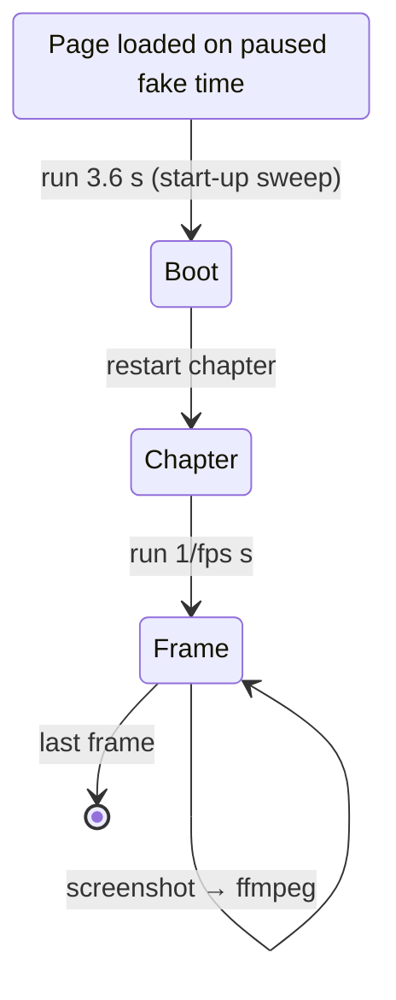

# Recording and media

**What it is.** The showcase's videos, card loops, README animation and share image, all recorded from the
live demo. Nothing is staged by hand: what you see is the real simulation.

**How it works.**

- **`?record=1`:** a clean 1920×1080 frame with the cluster, captions and chapter names. No header,
  buttons, landing or cursor. `&format=45` gives a 1080×1350 frame with large captions for social feeds.
- **`scripts/record-video.mjs`:** installs Playwright's fake clock, paused, before the page loads. The
  app's frame loop, timers and `performance.now` then advance exactly one frame (1/fps s) between
  screenshots. Frames are piped into ffmpeg.
  - Two runs give the same video; differences are only encoder and GPU noise on a few hundred pixels.
  - Capture runs at about 8 frames per second of real time, however slow the machine.
- **Clean starts:** each clip waits for the page-load start-up sweep, then restarts its chapter.
- **`scripts/make-media.mjs`:** the plan. It builds the highlight cut, the LinkedIn cut and the full video
  (into the git-ignored media folder), plus the card loops, the README WebP and the share image. Shots and timings:
  `docs/VIDEO_SCRIPT.md`.

**Found while recording:**

- **Motorway:** in a world that has been running (as on the site), the car ahead pulled out and blocked the
  passing car beside us. The script's cars now keep their lanes on a clear road.
- **City:** the car never met a red light, so the caption was wrong. A `redLight` event now times the
  lights.
- **Shutdown:** the car didn't switch off within the chapter. It now starts closer to the space.

Tests cover all three.

**Where.** `node scripts/make-media.mjs [loops readme og highlight full linkedin]`. Landing
cards play the loops while on screen (posters for reduced motion).
