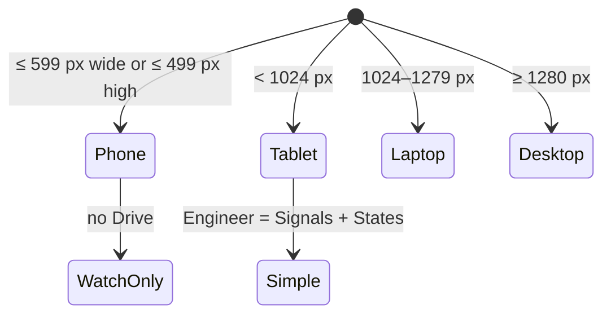

# Responsive behaviour and fallbacks

| Screen                                  | What the visitor gets                                                                         |
| --------------------------------------- | --------------------------------------------------------------------------------------------- |
| Desktop ≥ 1280 px                       | Everything; Engineer as a sidebar                                                             |
| Laptop 1024–1279 px                     | Same; the Drive dock drops its labels (tooltips on each group); Engineer below the cockpit    |
| Tablet (portrait)                       | Cockpit at full width, page continues below; Drive works by touch; Engineer: Signals + States |
| Phone landscape (< 500 px high)         | Cockpit at full width, one-line captions, chapter bar; "Best on desktop to drive"             |
| Phone portrait (< 600 px wide)          | Cockpit scaled to width; "Rotate for a bigger view" and "Best on desktop"; landing stacked    |
| Browser without canvas / ResizeObserver | A one-line note instead of the cockpit; no errors                                             |

**How.**

- **Device classes:** `src/app/shell/device.ts` has the queries.
- **Phones:** no Drive. The header offers Watch and Engineer, and a shared `?mode=drive` link opens
  Watch.
- **Portrait screens:** the stage is only as tall as its content, so there's no empty screen under the
  cockpit.
- **Keyboard hints:** shown on hover only on devices that can hover (a tap would leave them stuck on touch
  screens).
- **Older browsers:** `src/cluster/renderer/compat.ts` adds canvas `roundRect` (Safari < 16,
  Firefox < 112) and checks that the cluster can run at all. The cluster is Canvas 2D only, so WebGL is
  never needed.

**Where.** All modes. Tests: `e2e/smoke.spec.ts` (phones, the fallback note),
`src/cluster/renderer/compat.test.ts`.
