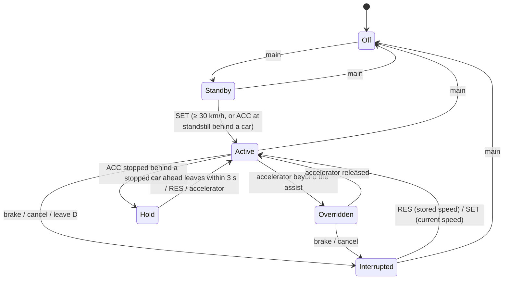

# Cruise control, adaptive cruise control and speed limiter

## Real-world behaviour this models

One state machine serves all three functions, as on the right-hand steering-wheel pad of most cars
since about 2015.

- **Main button**:
  - Short press switches the system on (standby) or off.
  - Long press swaps between cruise/ACC and the speed limiter.
  - Cars without radar have plain cruise control instead of ACC.
- **SET−**:
  - In standby or interrupted: engages at the current speed (minimum 30 km/h).
  - When engaged: −1 km/h; held, it goes down to the next multiple of 10.
- **RES+**:
  - Resumes the stored speed after an interruption.
  - When engaged: +1 km/h; held, it goes up to the next multiple of 10.
  - In stop & go hold: drives off.
- **Cancel**: interrupts and keeps the set speed. **Brake pedal**: same as cancel (except for the
  limiter).
- **Accelerator**: overrides while pressed further than the system would; releasing it returns
  control.
- **Distance**: five steps, 1.0 / 1.3 / 1.6 / 2.0 / 2.4 s time gap.
  - The default depends on the driving mode: Sport 2, Snow 5, otherwise 3.
  - The driving mode also sets how briskly ACC accelerates and brakes (gentle / normal / dynamic;
    Snow is gentle with a longer gap).
- **ACC**:
  - Follows the car ahead (radar range 150 m), keeping about 4 m plus speed × time gap.
  - It brakes at most 3.5 m/s². If it would need more, it issues a **take-over request**: flashing
    red, an urgent chime, and "Take over!".
- **Stop & go**: ACC follows the car ahead down to a standstill and holds the car.
  - If the car ahead moves off within 3 s, ACC follows on its own.
  - After a longer stop, the lead-car symbol flashes and "Press RES or the accelerator" appears.
- **Plain cruise control** needs 30 km/h to engage and drops out below 20 km/h. It ignores traffic.
- **Speed limiter**:
  - Caps the accelerator so the car stays at or below the set speed.
  - Kickdown (pedal to the floor) overrides it until the car is back under the limit.
  - It can't brake: downhill, more than 3 km/h over the limit for over a second makes the symbol flash
    amber and shows a warning with a chime.
- **Eco coasting** never happens while cruise or ACC is engaged.

## How it's simulated

| Part                                                                 | File                                                           |
| -------------------------------------------------------------------- | -------------------------------------------------------------- |
| State machine, gap/speed control, take-over, stop & go, limiter      | `core/assist/SpeedAssist.ts`                                   |
| Wanted acceleration → pedals (shared with the Demo driver)           | `core/assist/PedalController.ts`                               |
| Merge with the driver's pedals, lead from the scene, mode → dynamics | `core/datasource/simulator/SimulatorSource.ts` (`applyAssist`) |
| Demo driver uses ACC on the Autobahn                                 | `core/world/DemoDriver.ts` (`useAcc`)                          |
| Alerts (take-over, limiter exceeded, drive-off hint)                 | `core/alerts/rules.ts`                                         |
| Look per state (icon, colour, set text)                              | `cluster/widgets/speedAssist.ts`                               |
| Set speed in the gap, scale marker, distance graphic in the hub      | `cluster/widgets/RoundDial.ts`                                 |
| Status symbol in the top strip                                       | `cluster/widgets/StatusStrip.ts`                               |

ACC control law:

- `a = min(speed term, gap term)`, clamped to [−3.5, mode accel].
- Speed term: `0.4·(v_set − v)`.
- Gap term: `0.22·(gap − (4 + v·T)) + 0.75·(v_lead − v)`, which is the standard constant-time-gap
  controller.
- The `PedalController` then turns the wanted acceleration into throttle and brake.

The ACC's pedals are combined with the driver's:

- Throttle is the higher of the two.
- Brake comes from ACC. Any driver brake interrupts ACC first.
- The limiter caps the driver's throttle.

The Demo driver uses ACC on the Autobahn:

- It switches on and sets above 60 km/h, and adjusts the set speed to the limits ahead.
- It cancels about 1.5 km before the exit.
- It brakes on its own after a take-over request.

New signals (`Vehicle.ADAS.CruiseControl.*`):

- `State`: 0 off, 1 standby, 2 active, 3 overridden, 4 interrupted, 5 hold.
- `Function`: cruise / acc / limiter.
- `TimeGapLevel`
- `TargetDistance`: −1 when there is no target.
- `IsTakeoverRequested`, `IsTargetDrivingOff`
- `Vehicle.ADAS.SpeedLimiter.IsExceeded`

## Thresholds

| What                        | Value                  | Why                                         |
| --------------------------- | ---------------------- | ------------------------------------------- |
| Minimum set speed           | 30 km/h                | Common minimum for cruise/ACC/limiter       |
| Cruise drops out below      | 20 km/h                | Plain cruise isn't for traffic              |
| Time gaps                   | 1.0–2.4 s in 5 steps   | Typical ACC range                           |
| Standstill gap              | 4 m                    | Typical stop & go distance                  |
| ACC brake authority         | 3.5 m/s²               | ISO 15622 comfort range, beyond = take over |
| Take-over request           | wanted < −3.8 m/s²     | Hysteresis above the authority              |
| Auto resume after stop      | within 3 s             | Typical; longer needs driver confirmation   |
| Radar target range          | 150 m                  | Long-range radar                            |
| Limiter warning             | > set + 3 km/h for 1 s | Downhill overrun                            |
| Kickdown override (limiter) | pedal > 95 %           | Pressure point at the end of travel         |

## Where it appears

- **Speedometer gap:** the system symbol (cruise, ACC or limiter) with the set speed.
  - Green when active; the limiter is white when active.
  - White when overridden.
  - Grey when in standby or interrupted. In standby without a set speed it shows "– – –".
- **Speedometer scale:** a marker triangle at the set speed, in the same colour.
- **Speedometer hub (ACC):** five distance bars, lit up to the chosen setting, with the car ahead
  placed by its real distance. The car flashes when it moves off in stop & go.
- **Top strip:** the system symbol in its state colour.
- **Alerts:** "Take over!" (critical, repeating chime), "Speed limit exceeded" (warning), "Vehicle
  ahead is moving off" (info).
- **Website:** the main button's LED shows the system is on. Hold C for the limiter.

## Assumptions

- Predictive ACC (slowing for bends, adopting limits on its own) is not built. The speed limit is
  recognised and shown ([speed limits](speed-limits.md)), but ACC doesn't adopt it; the Demo driver
  adjusts the set speed itself.
- In the simulator the radar sees only the car in the ego lane (the scene's `lead`). Cut-ins appear
  when a car changes into our lane.
