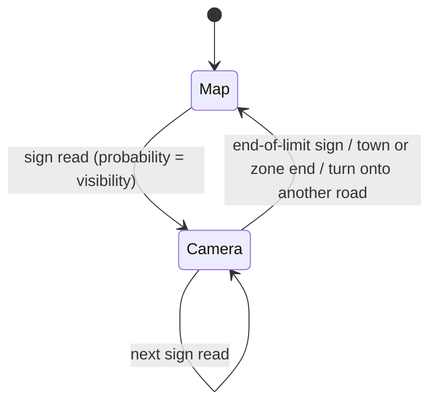
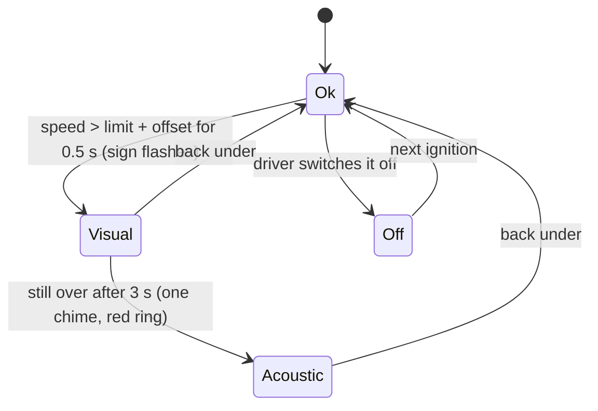

# Speed-limit recognition and speed warning (ISA)

## Real-world behaviour this models

- **Since July 2024 every new car in the EU** has intelligent speed assistance (Regulation (EU)
  2019/2144):
  - The current limit is always shown.
  - Going faster than it gives a warning: first visual (the sign flashes), then a short acoustic
    signal.
  - The system is **on at every start**. The driver may switch it off for the trip, usually in a
    deep settings menu.
  - Many cars let the driver add a tolerance (0 to +10 km/h).
- **Where the limit comes from:** a front camera reads the signs, and a navigation map fills in.
  - The camera reads supplementary plates: "when wet" applies while it rains (the car uses its rain
    sensor or wipers); a time range applies by the clock. The plate is drawn under the sign.
  - Town entry means 50, town exit means 100 (rural), a 30 zone means 30, the motorway sign means no
    general limit, and "end of all restrictions" means no limit (the Autobahn advisory 130 is shown
    next to the sign).
  - A camera reading holds until the next relevant sign, or until the car turns onto another road.
    Then the map is used.
  - The map knows permanent limits and implicit ones, but not temporary (roadworks) signs.
- **Recognition is not perfect.** A dirty, bent or hidden sign may be missed, and the car keeps
  showing the old limit until the next sign or turn. Drivers know this from real cars, so the
  simulator does it on purpose.

## How it's simulated

| Part                                               | File                                                             |
| -------------------------------------------------- | ---------------------------------------------------------------- |
| Camera + map fusion, plates, implicit limits       | `core/assist/SpeedLimitRecognition.ts` (`SpeedLimitRecognition`) |
| Warning cascade, offset, on at every start         | `core/assist/SpeedLimitRecognition.ts` (`IsaWarning`)            |
| Map database (no temporary signs)                  | `core/world/route.ts` (`mapLegalAt`)                             |
| Feeding newly passed signs, road changes, ignition | `core/datasource/simulator/SimulatorSource.ts` (`recognize`)     |
| Sign, plate, flashing/red ring                     | `cluster/widgets/StatusStrip.ts`, `cluster/telltales/signs.ts`   |
| Chime                                              | `app/audio/useClusterAudio.ts`                                   |
| Settings (on/off, tolerance)                       | Workshop drawer on the website                                   |

- Each route sign has a `visibility`, the probability that the camera reads it. The roll uses the
  simulator's seeded random generator, so every run is the same.
- One sign is deliberately unreadable: the 100 at the tunnel portal is hidden behind a truck. The
  cluster keeps showing 120 through the tunnel, and the map can't help because the car is still on
  the same road.
- Over the whole Demo route the shown limit matches the legal one about 95 % of the driving time.
  The test requires more than 85 %.

The cluster shows the **recognised** limit (signals `Vehicle.ADAS.SpeedLimitInfo.*`), never the
world's ground truth. With a real car's data the same widget works unchanged.

## Thresholds

| What                          | Value                              | Why                                |
| ----------------------------- | ---------------------------------- | ---------------------------------- |
| Visual warning                | > limit + offset for 0.5 s         | Ignores brief overshoot            |
| Acoustic warning              | after 3 s, once per episode        | EU ISA "cascaded" warning          |
| Episode reset                 | 2 s under the limit or a new limit | A new limit warrants a new warning |
| Offset                        | 0, 3, 5, 7, 10 km/h                | Common tolerance settings          |
| Default sign read probability | 0.95 (some signs lower)            | Plausible camera reliability       |

## Where it appears

- **Top strip, left of centre:**
  - The sign: a white disc with a red ring and the number, or "end of all restrictions" with the
    advisory speed beside it.
  - The no-overtaking sign next to it while a ban applies.
  - Any supplementary plate below it.
- **While over the limit:**
  - The sign flashes. Once the chime sounds, it stays ringed in red with a glow.
- **Website:** the Workshop drawer has "Speed warning" (on/off; it comes back on at every start) and
  the tolerance setting.

## Assumptions

- A map fallback with a "when wet" limit doesn't show the plate. Only the camera knows which sign it
  read.
- ACC does not adopt new limits on its own (predictive ACC is not built). The Demo driver adjusts
  the set speed itself.
- Bug fixed in this step: past a town-exit sign, the legal limit on a street segment is the rural
  limit. It used to stay at 50 until the next segment.
