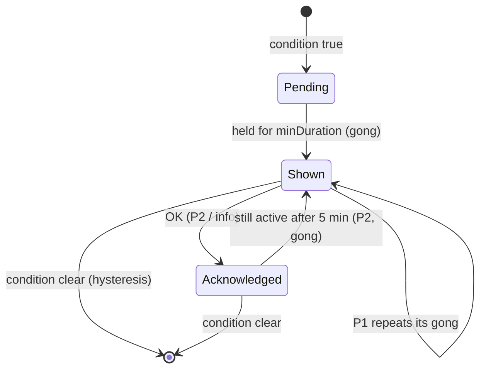
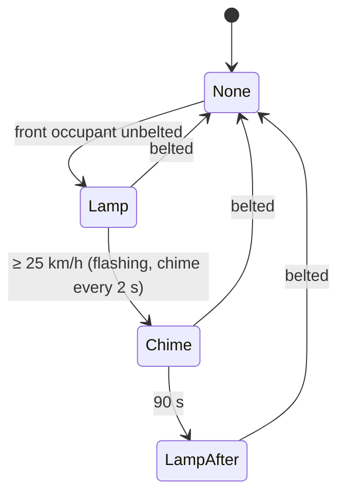

# Warnings and messages: catalogue, seat belts, tyre monitoring, service

## Real-world behaviour this models

- **Colours:** red means stop or danger, amber means attention, green/blue/white show a status.
  Telltale colours and positions are fixed (ISO 2575) and never themed.
- **Priorities:**
  - **Priority 1** (red, "stop safely"): a three-note gong, and the message stays until the problem
    is gone. The steering-wheel OK only hides the card; the lamp stays lit.
  - **Priority 2** (amber): one gong. It can be acknowledged and **comes back after 5 minutes** if
    still present.
  - **Information** (white): a soft bell.
  - Several messages of the same priority **take turns** (5 s each, with a "1/3" counter).
  - Acknowledged warnings that are still active show as a small triangle with their count in the
    bottom strip. The **Vehicle messages** page lists everything active.
- **Catalogue** (each with condition, colour, text, sound and, where cars have one, a telltale):

  | Message                           | Lamp                     | Sound / repeat               |
  | --------------------------------- | ------------------------ | ---------------------------- |
  | Oil pressure too low              | red oil can              | gong, every 20 s             |
  | Coolant temperature high          | red thermometer          | gong, every 20 s             |
  | Coolant level low                 | –                        | gong once                    |
  | Brake system fault                | red (!)                  | gong, every 30 s             |
  | Power steering fault              | amber wheel !            | gong once                    |
  | Charging system fault             | red battery              | gong once                    |
  | Bonnet open (moving / parked)     | car graphic              | gong every 8 s / once        |
  | Gearbox overheating               | –                        | gong once                    |
  | Airbag fault                      | red airbag               | gong once                    |
  | ABS fault                         | amber ABS                | gong once (ABS really off)   |
  | ESC active / off                  | amber, flashing / steady | –                            |
  | Engine fault                      | amber engine             | gong once                    |
  | Glow plugs, filter, exhaust fluid | amber                    | see powertrain helpers       |
  | Low fuel                          | amber pump               | gong, every 10 min           |
  | Washer fluid low                  | –                        | gong once                    |
  | Tyre pressure low                 | amber tyre (!)           | gong once                    |
  | Brake pads worn                   | –                        | gong once                    |
  | Check lights (bulb)               | –                        | gong once                    |
  | Seat belt                         | red, flashing            | see below                    |
  | Door / boot / bonnet open         | car graphic              | gong once / every 8 s moving |
  | Key battery low                   | –                        | bell                         |
  | Parking brake on while moving     | red (P)                  | gong every 3 s               |
  | Ice warning (≤ 3 °C)              | amber snowflake          | bell once                    |
  | Assists unavailable               | –                        | gong once                    |

- **Seat belts** (EU R16 / Euro NCAP style):
  - The lamp lights while anyone in front is unbelted.
  - Above 25 km/h the lamp **flashes with a chime every 2 s for 90 s**, then stays lit.
  - Rear seats: a **status card** (five seats, ticked or red) shows for 30 s after the start, and
    whenever a rear belt changes. Unbuckling on the move warns for 30 s.
- **Tyre monitoring:**
  - **Direct** (sensors in the wheels): the vehicle page shows each tyre's pressure and temperature,
    and the warning names the tyre.
  - **Indirect** (ABS wheel speeds; the 2016 estate): warning only. The driver must **store
    pressures** after inflating.
- **Service:** the flexible interval counts down kilometres and days. At every start it is announced
  when due within 1 000 km or 30 days, and overdue shows as an amber message.

## How it's simulated

| Part                                                   | File                                                         |
| ------------------------------------------------------ | ------------------------------------------------------------ |
| Priorities, return after 5 min, taking turns, list     | `core/alerts/AlertEngine.ts`                                 |
| Rules (conditions, severity, repeat) and texts (EN/PL) | `core/alerts/rules.ts`, `core/i18n/*.ts`                     |
| Seat-belt reminder, indirect TPMS, service interval    | `core/body/monitors.ts`                                      |
| Faults, occupants, tyre temperatures                   | `core/datasource/simulator/vehicle.ts`, `SimulatorSource.ts` |
| Popup card (car graphic for openings, counter)         | `cluster/widgets/system/AlertPopup.ts`                       |
| Belt status card                                       | `cluster/widgets/system/BeltStatus.ts`                       |
| Vehicle messages page, tyre values                     | `cluster/widgets/center/MessagesPage.ts`, `CarPage.ts`       |
| Waiting-messages indicator                             | `cluster/widgets/StatusStrip.ts`                             |

The Workshop drawer lists every fault and the occupant controls (driver belt, passenger, three rear
seats). It also has the service buttons (soon, overdue, done) and, on the estate, "Store tyre
pressures".

## Thresholds

| What                 | Value                              | Why                                 |
| -------------------- | ---------------------------------- | ----------------------------------- |
| Warning comes back   | 5 min after OK                     | Typical P2 behaviour                |
| Messages take turns  | every 5 s                          | Readable without waiting            |
| Seat-belt chime      | ≥ 25 km/h, 90 s, every 2 s         | EU R16 minimums                     |
| Rear belt status     | 30 s after start / change          | Typical                             |
| Indirect TPMS        | 20 % below stored for 8 s (moving) | Wheel-speed detection needs rolling |
| Direct TPMS          | < 1.9 bar                          | ~20 % under the placard             |
| Service announcement | < 1 000 km or < 30 days            | Typical flexible service            |

## Assumptions

- The faults are switches in the Workshop. Only ABS also changes behaviour (the wheels can lock).
- Ice warning stays at ≤ 3 °C; real cars use +3 to +4 °C.
