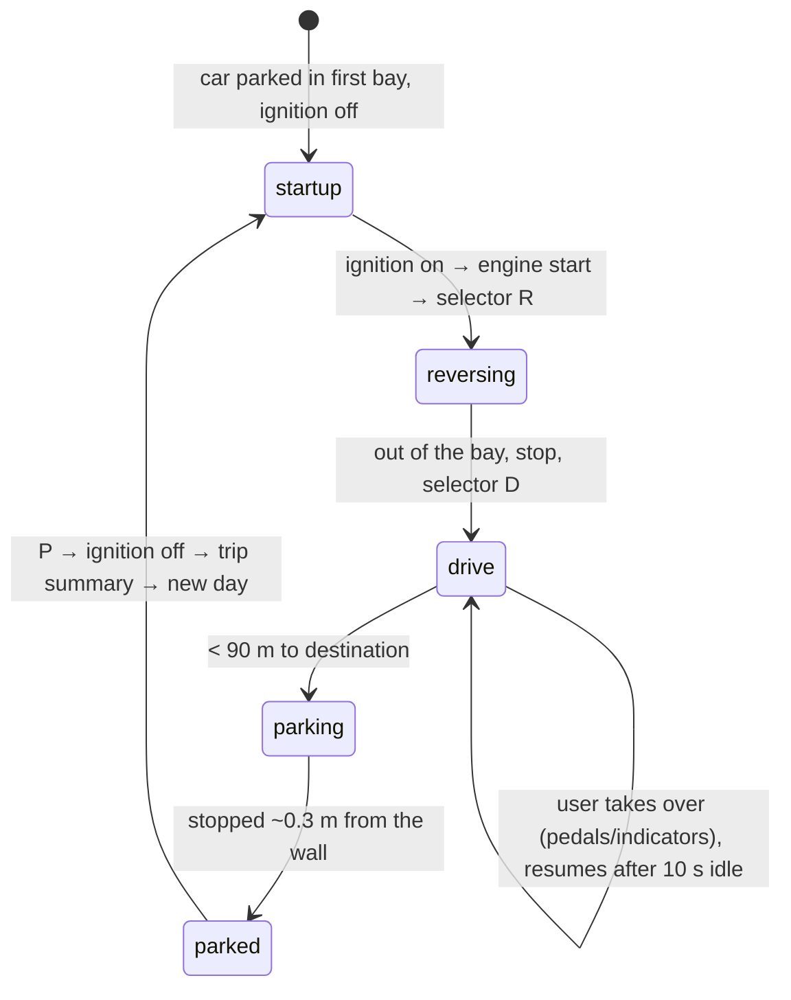

# World simulator and Demo drive

## Real-world behaviour this models

- **German speed limits (StVO):**
  - **Implicit limits:** 50 km/h inside towns (from the yellow town-entry sign to the exit sign),
    100 km/h outside towns, and no general limit on the Autobahn (advisory 130 km/h).
  - **Explicit signs:** a limit sign stays valid until an end sign, an "end of all restrictions" sign,
    or a change of context (town entry/exit, 30 zone, Autobahn start/end).
  - **Supplementary plates:** a plate can make a limit conditional, for example "when wet" or a
    time window such as school hours.
  - **Temporary (roadworks) signs** have a yellow background.
- **Traffic lights** run the German cycle green → amber → red → red + amber.
- **Keep right.** On multi-lane roads drivers overtake on the left and return to the right lane when
  it is clear.
- **Drivers** keep roughly a 1.5–2 s time gap ("half the speedometer" rule), take bends at about
  0.3 g lateral, and slow down for limit signs ahead.

## How it's simulated

| Part         | File                                                  | Notes                                                                                                                                                                                                                                                                 |
| ------------ | ----------------------------------------------------- | --------------------------------------------------------------------------------------------------------------------------------------------------------------------------------------------------------------------------------------------------------------------- |
| Route        | `core/world/template.ts`, `route.ts`                  | ~21 km. Segments are data with arcs, gradients, tunnel, lane drop, signs, features and events. Heading is integrated exactly; geometry is sampled every 2 m.                                                                                                          |
| Legal limits | `route.ts` (`buildLegal`, `legalAt`)                  | A timeline of legal state built from segment changes and signs; plates are evaluated against wet/hour.                                                                                                                                                                |
| Environment  | `core/world/environment.ts`                           | Time of day (or the real clock), weather, temperature and surface give daylight, tunnel darkening (~1 s), grip, wet road and rain.                                                                                                                                    |
| Traffic      | `core/world/traffic.ts`                               | Intelligent Driver Model per vehicle, keep-right lane changes with a side-by-side check, red-light stop lines, recycling around the ego car, oncoming cars. Events: slow truck in a no-overtaking zone, an Autobahn jam (stop & go), sudden braking by the car ahead. |
| Navigation   | `core/world/navigation.ts`                            | Manoeuvres from route features: turns, roundabout exit, Autobahn join, exit with lane guidance, destination. Remaining distance and ETA.                                                                                                                              |
| Scene        | `core/world/World.ts` → `SceneSnapshot`               | Object list (like a camera/radar), lead vehicle, signs passed, legal limit, traffic light, obstacle distances, navigation, environment.                                                                                                                               |
| Demo driver  | `core/world/DemoDriver.ts`                            | Speed choice, IDM car-following, lights, indicators, overtaking, bay exit and parking.                                                                                                                                                                                |
| Map          | `cluster/nav/scenery.ts`, `widgets/center/MapPage.ts` | Scenery generated around the route (town blocks, side streets, fields, forest, Autobahn, tunnel hill, car parks), drawn into a progressive raster cache.                                                                                                              |

## Demo drive states

## Thresholds and choices

| What                             | Value                                                      | Why                                             |
| -------------------------------- | ---------------------------------------------------------- | ----------------------------------------------- |
| Driver time gap                  | 1.7 s                                                      | "Half the speedometer" rule of thumb            |
| Bend lateral acceleration        | 0.28 g dry, 0.22 g wet, 0.12 g icy                         | Comfortable everyday driving                    |
| Speed around the limit           | +1 % Autobahn, +2 % town, +4 % rural, ±3 % slow drift      | Humans don't drive exactly at the limit         |
| Free speed on unlimited Autobahn | 135 km/h                                                   | Near the 130 advisory                           |
| Traffic IDM                      | a 1.6 m/s², b 2.2 m/s², T 1.4 s, s₀ 2.5 m (trucks gentler) | Typical published values                        |
| Lane change                      | 3.5 s (traffic), 4 s (ego), indicate 2.5 s before          | Normal manoeuvre timing                         |
| Light cycle                      | 22 s green / 3 s amber / 20 s red / 1.5 s red + amber      | Typical urban junction                          |
| Tunnel light adaptation          | ~1 s                                                       | Sensor reaction for auto headlights             |
| Demo resume after takeover       | 10 s without input                                         | Lets the visitor drive, then the demo continues |

## Where it appears

- **Map page:** route ahead, manoeuvre card with lane guidance, current road, ETA.
- **Bottom-strip clock:** world time.
- **Night dimming and auto headlights:** follow world light, including tunnels.
- **Later steps:** speed limits/ISA, ACC, lane assist, collision warning and parking all read the
  same scene.

## Tests

`core/world/route.test.ts`, `environment.test.ts`, `world.test.ts`, `demo.drive.test.ts`. The last one
drives the whole route in fast-forward and checks: reversing out, no red lights run, no limit
exceeded by more than 8 km/h, gap to the car ahead, and parking at the end.
