# Design story

## Before

The first website was a test bench: the control panel was as large as the cluster, the header used
developer language and the page opened parked, at night, with the engine off. About 6 s passed before
anything moved.

| Size      | Controls visible above the fold | Controls on the page | Cockpit moving                     |
| --------- | ------------------------------- | -------------------- | ---------------------------------- |
| 1920×1080 | 48                              | 106                  | ~6 s (starts parked, ignition off) |
| 1440×900  | 33                              | 106                  | ~6 s                               |
| Phone     | 25                              | 106                  | ~6 s                               |

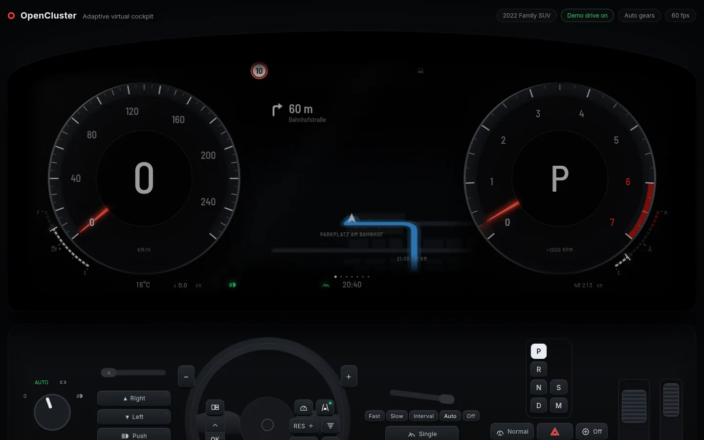

## Three concepts

- **A, Theatre:** the cluster under a dashboard hood, a video-player chapter bar, a glass dock below.
- **B, Driver's seat:** first person; the cluster above a big steering wheel, buttons on the spokes.
- **C, Editorial:** an edge-to-edge cluster, a magazine layout for chapters, flat control tiles.

| A                                | B                                | C                                |
| -------------------------------- | -------------------------------- | -------------------------------- |
| 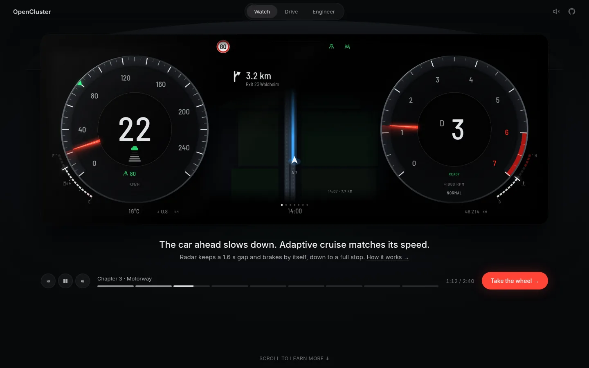 | 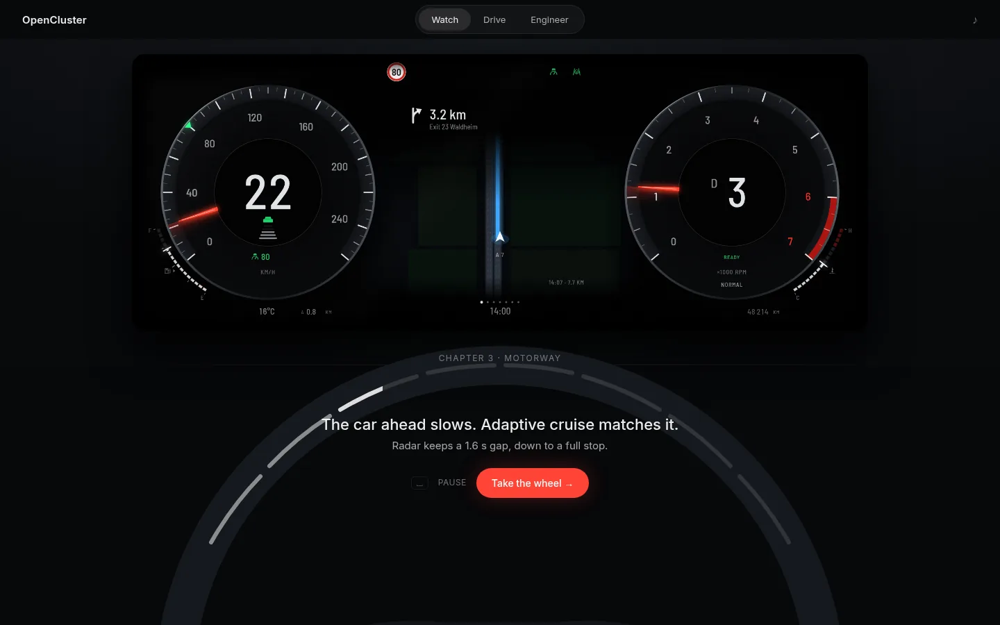 | 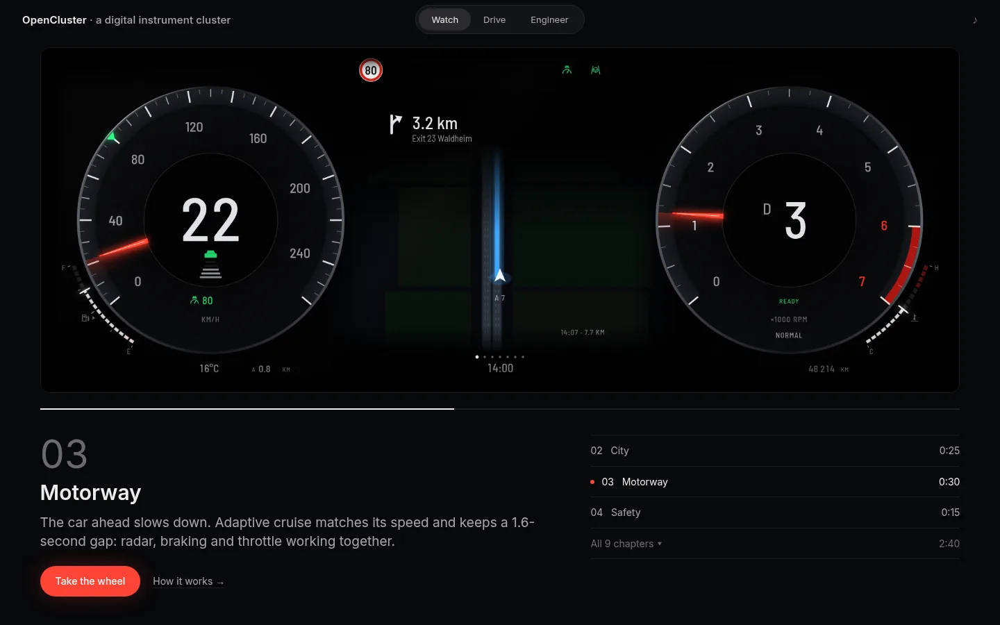 |

**Chosen:** A, with C's wider cluster and calm chapter typography, and B's spoke buttons in the Drive
dock.

| Watch (chosen concept)                    | Drive (chosen concept)                    |
| ----------------------------------------- | ----------------------------------------- |
| 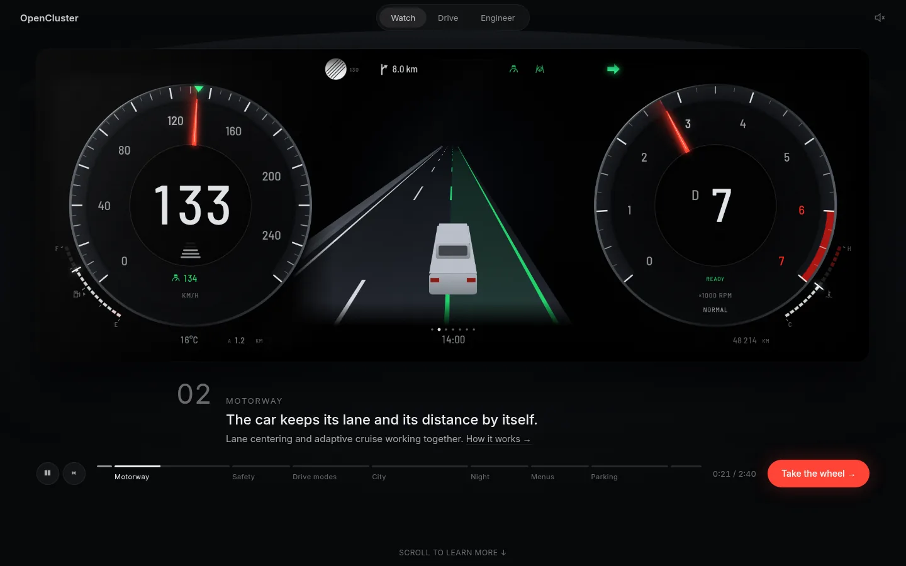 | 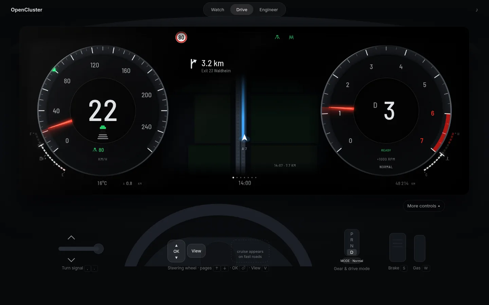 |

## Result

The cockpit moves within half a second, Watch shows at most a handful of controls, and Drive has at
most eight control groups at rest.

| Watch                           | Drive                           | Engineer                              |
| ------------------------------- | ------------------------------- | ------------------------------------- |
| 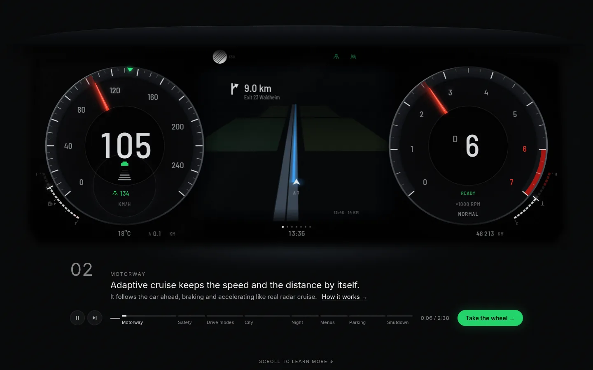 | 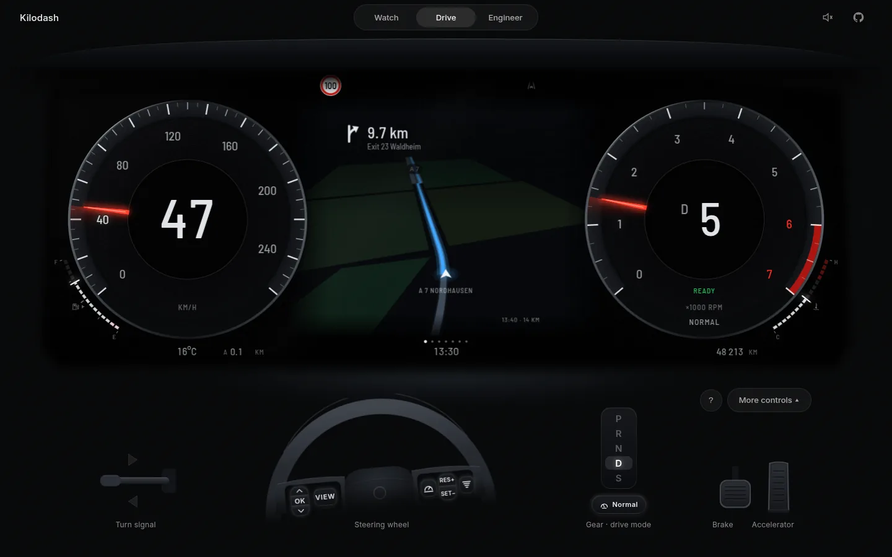 | 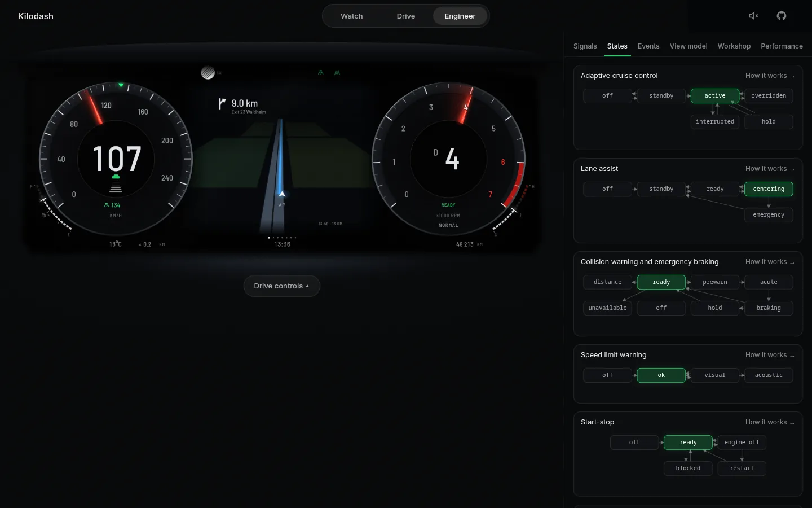 |

First visit: the hood lights up, the display wakes with its lamp check, then the header and captions
fade in.

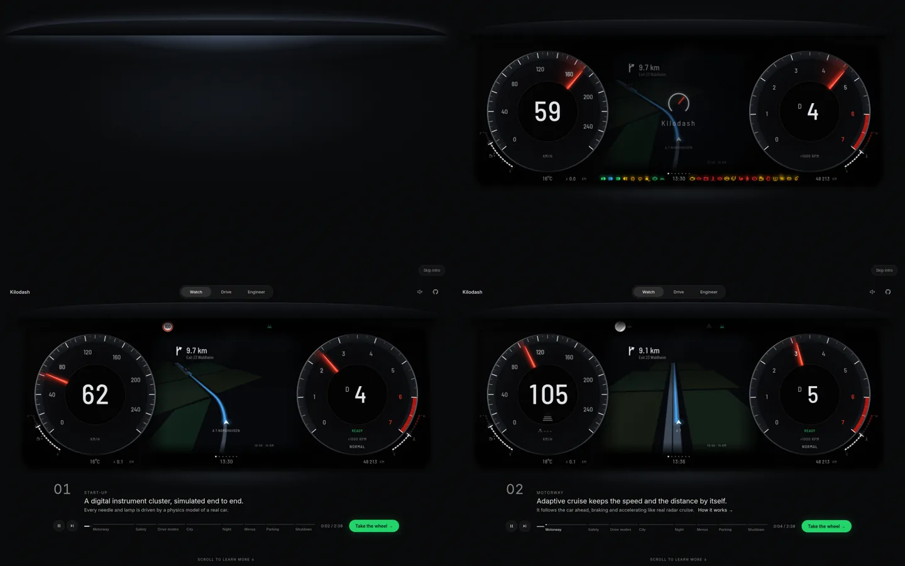

Phone portrait, tablet portrait and phone landscape:

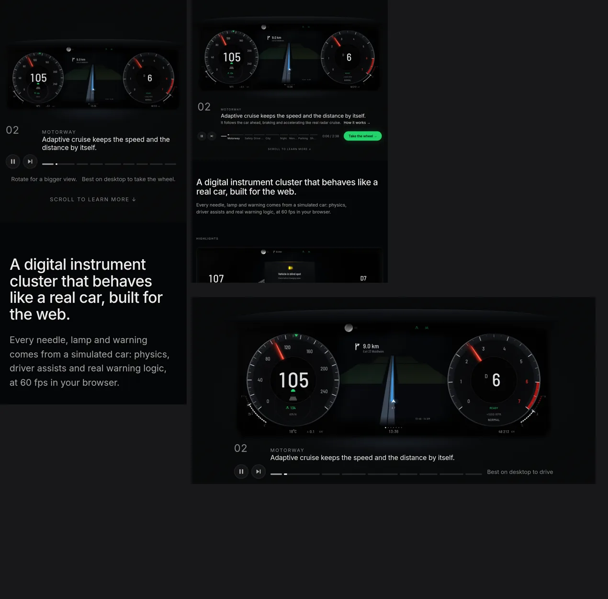
